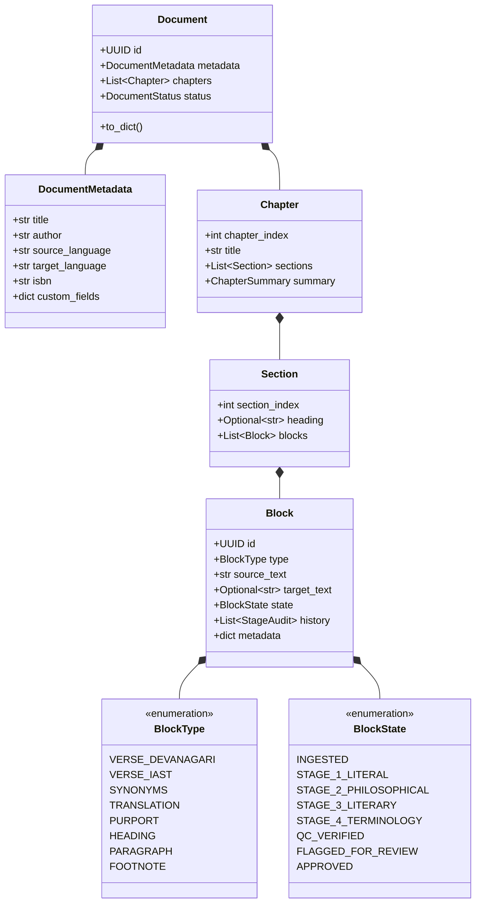
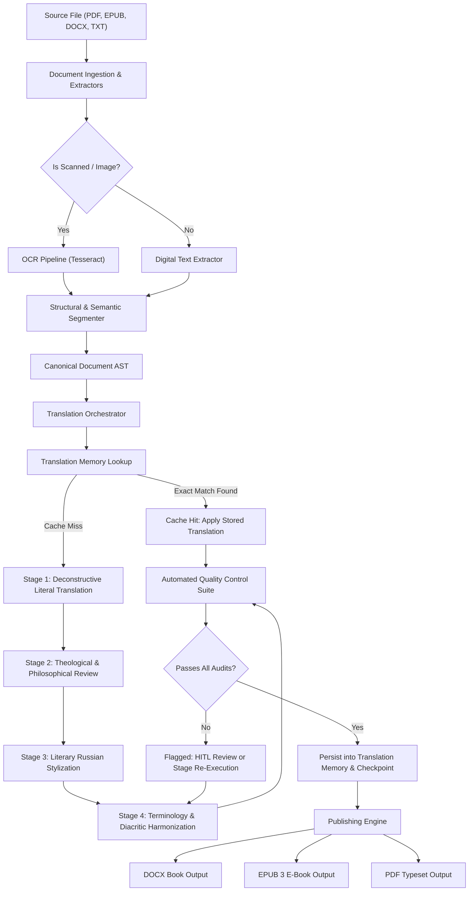
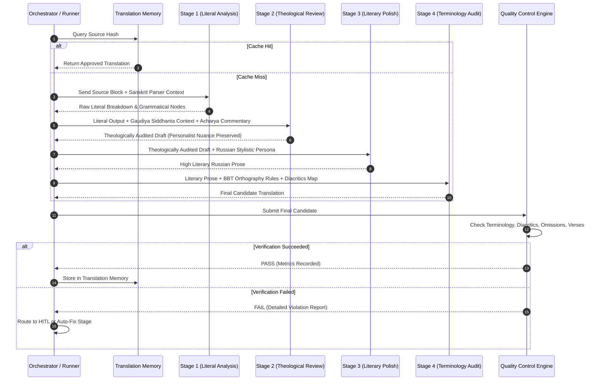

# System Architecture Specification

**Project Name**: Vedic Book Translator  
**Architecture Pattern**: Hexagonal Architecture (Ports & Adapters) with Event-Driven Pipeline  
**Target Runtimes**: Python 3.12+ (AsyncIO), Cross-Platform (Windows, Linux, macOS)  
**Document Version**: 1.0.0  
**Status**: Pending Architecture Approval  

---

## 1. Architectural Philosophy & Principles

The Vedic Book Translator is engineered as a modular, loosely-coupled, highly-extensible platform following the **Hexagonal Architecture (Ports and Adapters)** pattern.

### 1.1 Core Architectural Principles
1. **Separation of Concerns**: Core domain entities (Document AST, Translation Units, Terminology Models) are entirely agnostic of third-party frameworks, AI provider SDKs, and storage engines.
2. **Pluggable AI Adapters**: External LLM services (Google Gemini, Anthropic Claude, OpenAI, local vLLM/Ollama) interact with the core domain strictly through abstract interfaces (`Ports`). Adding a new AI provider requires implementing a new adapter without touching translation pipeline logic.
3. **Immutability of Ingestion**: Source documents are treated as read-only. Ingestion converts arbitrary documents into a canonical in-memory Abstract Syntax Tree (AST), which is then processed through pipeline stages into new target formats.
4. **Idempotence & Resumability**: Every step in the translation and auditing lifecycle writes atomic checkpoints to a persistent store. If processing is interrupted, the job resumes from the last completed block.
5. **Multi-Stage Orchestration**: Rather than relying on a single, lossy prompt, translation is factored into four specialized, auditable stages: Literal Analysis, Theological Alignment, Literary Styling, and Terminology Harmonization.

---

## 2. System Decomposition & Subsystem Responsibilities

```
+----------------------------------------------------------------------------------------------------+
|                                    CLI & Orchestration Layer                                       |
|                              (Job Manager, Runner, Progress UI)                                    |
+----------------------------------------------------------------------------------------------------+
           |                                       |                                      |
           v                                       v                                      v
+-----------------------+              +-----------------------+              +-----------------------+
|   Document Processor  |              |   Translation Engine  |              |   Publishing Engine   |
| (Ingestion, OCR, AST) |              |  (4-Stage Multi-LLM)  |              | (DOCX, EPUB, PDF, MD) |
+-----------------------+              +-----------------------+              +-----------------------+
           |                                       |                                      |
           |                  +--------------------+--------------------+                 |
           |                  |                                         |                 |
           v                  v                                         v                 v
+--------------------------------------+                     +--------------------------------------+
|       Domain AST & Core Models       |                     |     Quality Control & Auditing       |
| (Document, Chapter, Section, Block)  |                     | (Terminology, Diacritics, Integrity) |
+--------------------------------------+                     +--------------------------------------+
                              |                                         |
                              v                                         v
+----------------------------------------------------------------------------------------------------+
|                                    Memory & Storage Subsystem                                      |
|                  (Translation Memory, Terminology Database, Job Checkpoints)                       |
+----------------------------------------------------------------------------------------------------+
```

### 2.1 Subsystem Responsibilities

#### Subsystem 1: Document Processor
- **Primary Function**: Ingest arbitrary input files and convert them into a typed, structured **Document AST**.
- **Key Modules**:
  - `extractors/`: Format-specific parsers (`pdf.py`, `epub.py`, `docx.py`, `txt.py`).
  - `ocr/`: Optical Character Recognition pipeline with image pre-processing for scanned Sanskrit and Russian texts.
  - `segmenter/`: Rule-based and model-assisted semantic splitter that classifies text blocks into Verses (Devanagari/IAST), Synonyms, Translations, Purports, and Narrative Paragraphs.

#### Subsystem 2: Translation Engine
- **Primary Function**: Transform segmented source blocks into high-fidelity Russian text across four discrete, specialized stages.
- **Key Modules**:
  - `providers/`: Concrete adapters for Google Gemini, Anthropic Claude, OpenAI, and Local LLMs.
  - `prompts/`: Versioned prompt templates tailored to each stage and textual genre.
  - `pipeline/`: Four sequential transformation stages:
    1. `literal_stage.py`: Morphological deconstruction and lexical mapping.
    2. `philosophical_stage.py`: Gaudiya Vaishnava Siddhanta and commentary alignment.
    3. `literary_stage.py`: Russian stylistic elegance and rhythmic prose refinement.
    4. `terminology_stage.py`: Strict BBT Russian orthography and diacritical harmonization.
  - `context_manager.py`: Injects relevant chapter synopsis, dramatis personae, and preceding narrative into model prompts.

#### Subsystem 3: Quality Control & Auditing System
- **Primary Function**: Continuous, automated verification of translations against linguistic, theological, and structural invariants.
- **Key Modules**:
  - `term_auditor.py`: Scans final text against the approved Vaishnava terminology database for unauthorized variations or forbidden Mayavada terms.
  - `diacritics_auditor.py`: Audits Roman transliterations and Cyrillic scholarly forms for complete, correct Unicode diacritical marks.
  - `verse_integrity.py`: Verifies that verse numbering is intact, no lines were dropped, and multi-verse groupings match the source.
  - `hallucination_checker.py`: Detects content omission, excessive elaboration, or hallucinations by analyzing token and semantic ratios.

#### Subsystem 4: Publishing Engine
- **Primary Function**: Format and render the translated AST into publication-quality distribution documents.
- **Key Modules**:
  - `docx_exporter.py`: Generates Microsoft Word files with dedicated paragraph styles (Verse, Synonyms, Purport, Heading), dynamic TOC, and footnotes.
  - `epub_exporter.py`: Compiles EPUB 3 e-books with semantic HTML5 tags, embedded fonts, and navigation metadata.
  - `pdf_exporter.py`: Compiles print-ready PDFs with dual-script typography (Devanagari + Cyrillic), running headers, and page numbers.
  - `typography/`: Unicode normalization, Devanagari ligature verification, and Russian typographic rules (non-breaking spaces, em-dashes, quotation marks).

#### Subsystem 5: Memory & Glossary Subsystem
- **Primary Function**: Manage persistent linguistic assets across sessions and books.
- **Key Modules**:
  - `terminology_db.py`: SQLite-backed dictionary of Gaudiya Vaishnava terms, proper nouns, places, and declension tables.
  - `translation_memory.py`: Exact and fuzzy-match segment cache storing source hashes and approved translations to avoid redundant API spend.
  - `context_store.py`: Persistent storage of entity registers and chapter summaries.

#### Subsystem 6: Orchestrator & Job Lifecycle
- **Primary Function**: Oversee job execution, state persistence, concurrency control, and progress reporting.
- **Key Modules**:
  - `job_manager.py`: Manages job queues, active workers, rate-limiting, and error handling.
  - `checkpoint.py`: Atomic state serialization ensuring complete recovery after process interruption.
  - `runner.py`: CLI entry point (Typer-based) providing commands for translation, status checks, and exports.

---

## 3. Canonical Document AST (Abstract Syntax Tree)

To guarantee that all subsystems operate on a unified data structure, the system uses a strongly-typed hierarchical AST built on **Pydantic v2**:



---

## 4. End-to-End Processing Workflow



---

## 5. The 4-Stage Multi-LLM Translation Pipeline



---

## 6. Core Abstract Interfaces (Ports)

To enforce strict decoupling, all subsystems interact through formal abstract base classes (Ports):

### 6.1 Ingestion Port (`IDocumentExtractor`)
```python
from abc import ABC, abstractmethod
from pathlib import Path
from vedic_translator.core.models import Document

class IDocumentExtractor(ABC):
    @abstractmethod
    async def extract(self, file_path: Path) -> Document:
        """Extract source file into raw Document AST."""
        pass

    @abstractmethod
    def supports_format(self, extension: str) -> bool:
        """Check if extractor supports given file extension."""
        pass
```

### 6.2 AI Provider Port (`ITranslationProvider`)
```python
from abc import ABC, abstractmethod
from typing import Dict, Any, Optional

class ITranslationProvider(ABC):
    @abstractmethod
    async def generate_completion(
        self,
        system_prompt: str,
        user_prompt: str,
        temperature: float = 0.2,
        model: Optional[str] = None,
        extra_params: Optional[Dict[str, Any]] = None
    ) -> str:
        """Call AI provider model and return generated text."""
        pass

    @property
    @abstractmethod
    def provider_name(self) -> str:
        """Return provider identifier (e.g., 'gemini', 'anthropic', 'openai')."""
        pass
```

### 6.3 Translation Stage Port (`ITranslationStage`)
```python
from abc import ABC, abstractmethod
from vedic_translator.core.models import Block, ChapterContext

class ITranslationStage(ABC):
    @abstractmethod
    async def process_block(self, block: Block, context: ChapterContext) -> Block:
        """Execute specific translation transformation stage on a block."""
        pass

    @property
    @abstractmethod
    def stage_name(self) -> str:
        """Return stage identifier."""
        pass
```

### 6.4 Quality Auditor Port (`IQualityAuditor`)
```python
from abc import ABC, abstractmethod
from vedic_translator.core.models import Block, AuditResult

class IQualityAuditor(ABC):
    @abstractmethod
    async def audit_block(self, block: Block) -> AuditResult:
        """Audit block and return pass/fail with diagnostic findings."""
        pass
```

### 6.5 Publishing Exporter Port (`IPublishingExporter`)
```python
from abc import ABC, abstractmethod
from pathlib import Path
from vedic_translator.core.models import Document

class IPublishingExporter(ABC):
    @abstractmethod
    async def export(self, document: Document, output_path: Path) -> Path:
        """Serialize Document AST into publication target file."""
        pass
```

---

## 7. Storage & Persistence Architecture

The system utilizes an embedded, zero-dependency, transactional persistence layer built on **SQLite 3**:

1. **`translations.db` (Translation Memory & Job Checkpoints)**:
   - `jobs`: Tracks overall book translation status, active settings, and completion percentage.
   - `blocks`: Stores every AST block with its source hash, state, and intermediate stage outputs.
   - `translation_memory`: Key-value cache indexing `SHA256(source_text + context_domain)` to approved Russian translation.
2. **`terminology.db` (Vedic & Gaudiya Lexicon)**:
   - `terms`: Sanskrit term (IAST & Devanagari), standard English equivalent, approved BBT Russian equivalent, grammatical declension class, theological definition, forbidden translations.
   - `proper_names`: Deities, sages, avatars, places (e.g., *Navadvīpa* → Навадвипа, *Vṛndāvana* → Вриндаван).
3. **`checkpoints/` (File System Mirror)**:
   - Atomic JSONL checkpoints written per chapter to allow recovery and manual Git auditing.

---

## 8. Resilience, Concurrency & Fault Tolerance

1. **Token Bucket Rate Limiting**: AI providers operate behind token-bucket rate limiters configured to adhere to each provider's Tier limits (requests per minute and tokens per minute).
2. **Exponential Backoff with Jitter**: Transient network failures, HTTP 429 (Rate Limit), and HTTP 503 (Overloaded) trigger exponential backoff:
   $$\text{delay} = \min(\text{max\_delay}, \text{base\_delay} \times 2^{\text{attempt}}) \pm \text{jitter}$$
3. **Graceful Degradation & Provider Failover**: If the primary provider (e.g., Anthropic Claude) experiences consecutive timeouts or outages, the orchestrator can automatically route subsequent requests to an approved fallback provider (e.g., Google Gemini or OpenAI).
4. **Crash Recovery**: When executing a translation job, the system registers signal handlers (`SIGINT`, `SIGTERM`). On termination, current in-flight blocks are safely checkpointed. On restart, the orchestrator detects existing checkpoints and resumes seamlessly.
