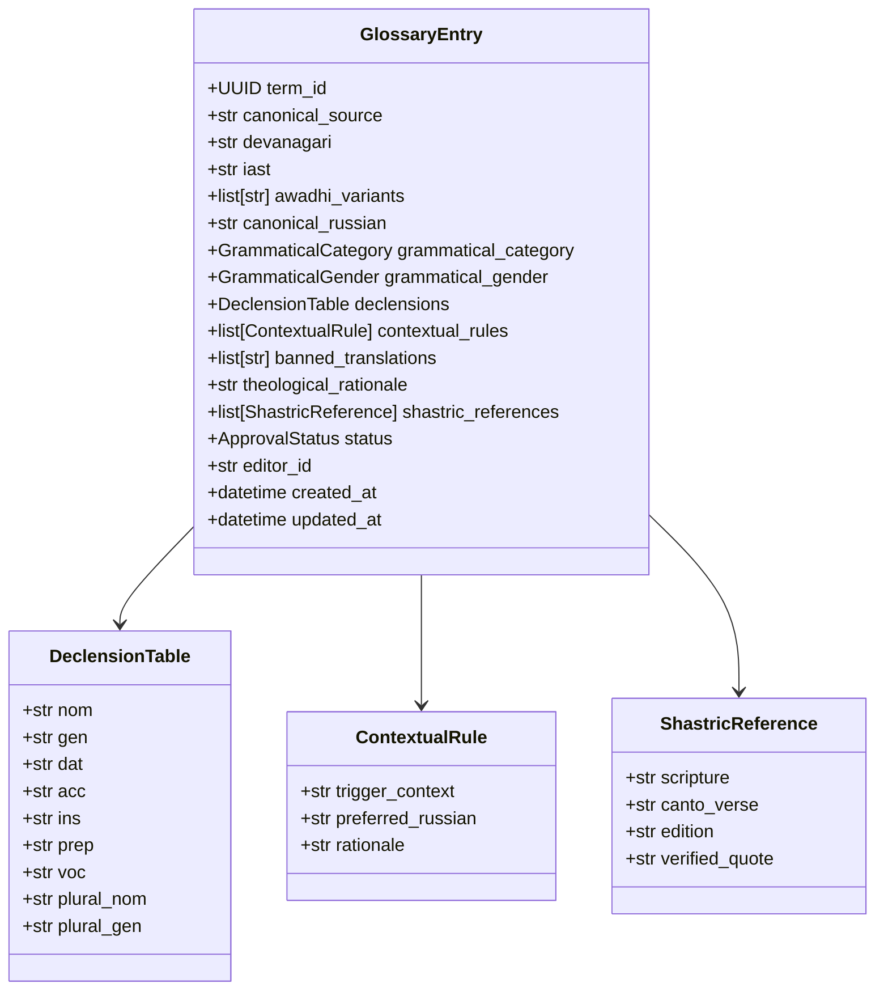
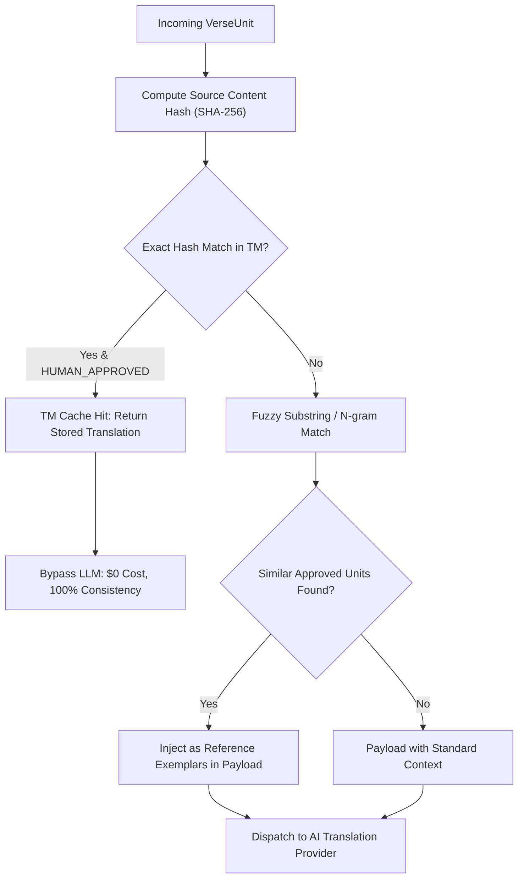
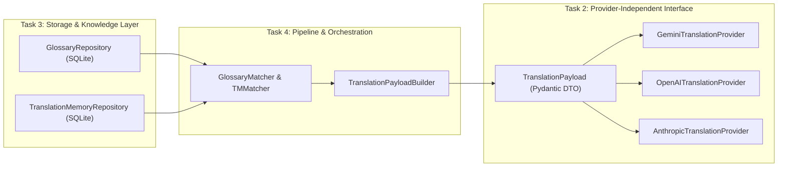
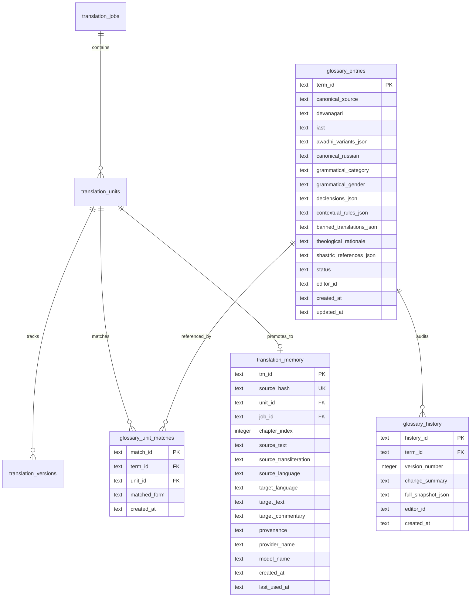

# MVP B — Task 3 Implementation Design: Vaishnava Glossary and Translation Memory

**Document**: `docs/mvp-b-glossary-and-tm-design.md`  
**Status**: DRAFT FOR ARCHITECTURAL APPROVAL  
**Target Book**: Gita Press *Ramcharit Manas* (1,200 pages, Awadhi / Hindi / Sanskrit / English)  
**Deliverable**: Production-grade Vaishnava Glossary and Translation Memory Subsystems  
**Baseline**: Git commit `363abd9` + Task 1 & Task 2 checkpoints (SQLite WAL Storage & Gemini Provider)

---

## 1. Executive Summary & Theological Foundations

### 1.1 Objective
The purpose of **Task 3** is to design and implement a domain-specific **Vaishnava Glossary** and **Translation Memory (TM)** subsystem for the Russian Translation Engine.

In translating Goswami Tulsidas's *Sri Ramcharit Manas*, translation quality depends directly on **theological fidelity (*siddhānta*)** and **literary register (*rasa*)**. Sacred Vedic texts cannot be processed using generic machine translation dictionaries; doing so invariably introduces secular, impersonal (*māyāvāda*), or Western ecclesiastical distortions.

### 1.2 Theological & Philological Foundations
1. **Authoritative Source is the Awadhi Verse**:
   The primary source is the original Awadhi verse in Devanagari supported by its phonetic IAST transliteration. The Gita Press English translation serves solely as an auxiliary aid to clarify archaic 16th-century Awadhi idioms, never as a translation pivot.
2. **Personalist Siddhānta (Brahma-Mādhva-Gauḍīya Tradition)**:
   In accordance with the Gaudiya Vaishnava tradition (*acintya-bhedābheda-tattva*), God is eternally a Person (*Bhagavān*), endowed with transcendental names, forms, qualities, pastimes, and energies.
3. **The Threefold Absolute (*Śrīmad-Bhāgavatam* 1.2.11)**:
   - **Brahman**: *безличный Брахман*, *сияние Брахмана* (never generic "God" or "Cosmic Mind").
   - **Paramātmā**: *Параматма*, *Сверхдуша* (the localized Supersoul within the heart).
   - **Bhagavān**: *Бхагаван*, *Всевышний*, *Верховная Личность Бога* (the personal Supreme Lord possessing all opulences).
4. **Authoritative Lexical Benchmark: Russian BBT Standards**:
   The Bhaktivedanta Book Trust (BBT) Russian publications (*Bhagavad-gita As It Is*, *Srimad Bhagavatam*, *Sri Chaitanya Charitamrita*) establish the definitive literary, orthographic, and declension standards for Gaudiya Vaishnava literature in Russian. Task 3 adopts these established norms to ensure the translation resonates with decades of elevated devotional scholarship.
5. **Strict Terminology Gate**:
   Secular or misleading equivalents (e.g. rendering *bhakti* as "культ" or "обожание", *kāma* and *prema* both as "любовь", *māyā* as "небытие", or *devas* as "боги") are strictly classified as **banned alternatives** and intercepted before publication.

---

## 2. Vaishnava Glossary Architecture

### 2.1 Glossary Domain Model
A glossary entry in Vedic Book Translator is not a flat dictionary pair. It is a multi-dimensional lexical entity capturing scriptural forms, Awadhi dialectal inflections, Russian declension cases, contextual disambiguation rules, prohibited terms, and verifiable shastric citations.



### 2.2 Detailed Entry Attributes

| Field Name | Type | Description | Example |
| :--- | :--- | :--- | :--- |
| `term_id` | UUID | Primary key. | `d3b07384-d113-4f24-9b16-5b4d70b0ff12` |
| `canonical_source` | String | Standard reference key (IAST / Devanagari). | `Kṛpā / कृपा` |
| `devanagari` | String | Script form in Devanagari. | `कृपा` |
| `iast` | String | Standard Unicode IAST transliteration. | `kṛpā` |
| `awadhi_variants` | List[String] | Dialectal and phonetic variations occurring in Tulsidas's Awadhi. | `["कृपा", "करुना", "कृपालु", "कृपा-सिंधु"]` |
| `canonical_russian` | String | Primary literary Russian rendering (Nominative sing.). | `Милость` |
| `grammatical_category` | Enum | Classification of term nature. | `DIVINE_ATTRIBUTE` |
| `grammatical_gender` | Enum | Russian gender: `M`, `F`, `N`, `PL`, `INDECLINABLE`. | `F` |
| `declensions` | JSON Object | Complete Russian 6-case paradigm (+ vocative). | `{"nom": "милость", "gen": "милости", "dat": "милости", "acc": "милость", "ins": "милостью", "prep": "о милости", "voc": "о милость"}` |
| `contextual_rules` | JSON Array | Sense selection based on narrative role or speaker. | `[{"trigger": "Epithet of Rama (kṛpālu)", "preferred": "Всемилостивый", "rationale": "Applies to Supreme Lord"}]` |
| `banned_translations` | JSON Array | Secular, Christianizing, or impersonalist renderings that trigger QC failure. | `["жалость", "пощада", "снисхождение"]` |
| `theological_rationale` | String | Clear Gaudiya Vaishnava explanation of the term. | `Unconditional divine grace bestowed by the Supreme Lord upon His surrendered devotees (bhaktas).` |
| `shastric_references` | JSON Array | Verified scripture citations supporting this definition. | `[{"scripture": "Bhagavad-gita As It Is", "verse": "18.56", "edition": "BBT 2007", "quote": "māt-prasādād avāpnoti..."}]` |
| `status` | Enum | Approval lifecycle: `PROPOSED`, `VERIFIED`, `APPROVED`, `REJECTED`. | `APPROVED` |

### 2.3 Grammatical Categories
1. **`PROPER_NAME`**: Personal names of divine personalities, avatars, sages, and characters (e.g. *Rāma*, *Sītā*, *Lakṣmaṇa*, *Bharata*, *Kausalyā*, *Vasiṣṭha*).
2. **`EPITHET`**: Reverential divine titles and descriptive attributes (e.g. *Raghupati*, *Kṛpānidhi*, *Asura-ari*, *Dīnadayāla*).
3. **`PHILOSOPHICAL_TERM`**: Metaphysical concepts defining ontology, cosmology, and theology (e.g. *māyā*, *bhakti*, *dharma*, *brahman*, *paramātmā*, *guṇa*, *jīva*).
4. **`DIVINE_ENTITY`**: Classes of beings in Vedic cosmology (e.g. *bhagavān*, *avatāra*, *deva*, *asura*, *gandharva*, *ṛṣi*).
5. **`SACRED_METAPHOR`**: Classical poetic metaphors intrinsic to Bhakti literature (e.g. *caraṇa-kamala* $\rightarrow$ *лотосные стопы*, *pada-paṅkaja* $\rightarrow$ *лотосные стопы*, *bhava-sāgara* $\rightarrow$ *океан материального бытия*).
6. **`GENERAL_TERM`**: Contextually sensitive high-frequency vocabulary requiring guidance (e.g. *sevā*, *darśana*, *prāda*, *līlā*).

### 2.4 Editorial Approval Lifecycle
To ensure glossary integrity and eliminate hallucinated definitions:
- **`PROPOSED`**: Newly discovered term extracted by pipeline or suggested by an editor. Never injected into production translation prompts.
- **`VERIFIED`**: Philologically verified against Sanskrit/Awadhi grammar and dictionaries, but awaiting theological review.
- **`APPROVED`**: Fully validated by senior Vaishnava editorial authority with complete declension tables and shastric citations. Active in translation prompt injection and rule-based QC auditing.
- **`REJECTED`**: Reviewed and found inaccurate or redundant. Retained for historical audit with explanatory rationale.

---

## 3. Context-Sensitive Terminology & Disambiguation Engine

### 3.1 The Problem of Polysemy in Sacred Awadhi Poetry
In Goswami Tulsidas's *Ramcharit Manas*, word roots frequently carry distinct meanings depending on poetic meter, narrative speaker, and philosophical context:

```
+---------------------------------------------------------------------------------------------------+
| Term: HARI (हरि)                                                                                  |
| - Context A (Bala Kanda, Stuti): Supreme Lord Sri Rama/Vishnu    -> «Хари», «Господь Хари»        |
| - Context B (Kishkindha Kanda, Vanara Army): Monkey / Vanara     -> «обезьяна», «воин-ванара»     |
| - Context C (Aranya Kanda, Metaphor): Lion / Predator            -> «лев»                         |
+---------------------------------------------------------------------------------------------------+
| Term: PRABHU (प्रभु)                                                                             |
| - Context A (Prayer by Kausalya): The Supreme Master / Lord      -> «Господь», «Владыка Вселенной»|
| - Context B (Citizen addressing King Dasharatha): Sovereign/King -> «государь», «повелитель»      |
+---------------------------------------------------------------------------------------------------+
| Term: DHARMA (धर्म)                                                                              |
| - Context A (Cosmic/Spiritual duty): Eternal constitutional nature-> «вечная дхарма», «служение»  |
| - Context B (Social order of Dasharatha's realm): Righteousness  -> «праведность», «благочестие»  |
+---------------------------------------------------------------------------------------------------+
```

### 3.2 Contextual Disambiguation Rules
The `GlossaryMatcher` does not execute flat text search. It evaluates context using structured cues:
1. **Narrative Episode & Active Speakers**:
   Extracted from MVP A unit context (e.g. `canto_name: "Bala Kanda"`, `active_speakers: "Kausalya / Stuti"`). When a prayer or stuti is active, epithets resolve to their elevated divine personalist senses.
2. **Grammatical & Syntactic Context**:
   - Compound words (*samāsas*): When *Hari* is compounded with divine attributes (*Hari-pada-kamala*), it resolves strictly to *Supreme Lord*.
   - Vocative case (*sambodhana*): Addresses in direct dialogue resolve based on speaker-listener hierarchy.
3. **Glossary Term Rule Engine**:
   Each `GlossaryEntry` contains an optional `contextual_rules` array. If the unit's metadata matches the rule's conditions, the preferred context-specific Russian equivalent overrides the default entry.
4. **Ambiguity Escalation**:
   If an ambiguous term lacks an applicable rule, the term is injected with an explicit ambiguity indicator in `GlossaryTerm.notes`, instructing the LLM to consult the auxiliary English reference and flag `theological_clarity: "MEDIUM"` for editorial verification.

---

## 4. Translation Memory (TM) Architecture

### 4.1 Tiered Architecture: Exact vs. Fuzzy



### 4.2 Exact Match Tier (`SHA-256`)
1. **Invariant**: Normalizes original Awadhi text (stripping leading/trailing whitespace, normalizing diacritics and danda characters `।`, `॥`).
2. **Zero-Cost Ingestion**:
   In the *Ramcharit Manas*, sacred refrains and invocations repeat across Cantos (e.g. *«मंगल भवन अमंगल हारी...»*). When an exact match with `provenance = 'HUMAN_APPROVED'` exists:
   - The AI provider call is **completely skipped**.
   - The existing approved Russian translation is reused verbatim.
   - Cost is \$0.00, latency is < 2ms, and 100% stylistic consistency across identical verses is guaranteed.

### 4.3 Fuzzy Similarity Tier (Few-Shot Prompt Exemplars)
1. For verses with partial repetition (e.g. similar metrical lines or shared grammatical constructions), the TM retrieves the top 1–2 most similar approved verses ($> 80\%$ similarity score).
2. These are injected into `TranslationPayload.metadata["tm_exemplars"]` as high-quality few-shot examples for the LLM.

### 4.4 Strict Provenance & Memory Isolation
* **Authoritative TM Entries**:
  - `provenance` must be either `HUMAN_APPROVED` (direct human sign-off) or `HUMAN_EDITED` (human editor modified Russian text).
* **AI Drafts are NEVER Authoritative**:
  - Raw AI-generated drafts are **strictly forbidden** from entering `translation_memory`. Unapproved AI completions can hallucinate subtle theological inaccuracies; allowing them into TM would cause systematic error amplification across subsequent units.
* **Reverse Synchronization**:
  - When an editor saves a revised verse in the review interface (`HUMAN_EDIT`), the new Russian text is automatically upserted into `translation_memory` with `provenance = 'HUMAN_EDITED'`, updating `last_used_at`.

---

## 5. Provider-Neutral Integration & Payload Assembly

### 5.1 Decoupled Architecture



### 5.2 Decoupling Invariants
1. **Zero Database Dependencies in Providers**:
   Neither `GeminiTranslationProvider` nor future OpenAI/Anthropic providers know about SQLite, migrations, or database queries. They receive pure, typed Pydantic models: `TranslationPayload.glossary_terms: list[GlossaryTerm]`.
2. **Standardized DTO Contract**:
   Uses the existing `GlossaryTerm` defined in [src/vedic_translator/translation_engine/providers/base.py](file:///C:/Users/Ameya/Desktop/vedic-book-translator/src/vedic_translator/translation_engine/providers/base.py#L27-L34):
   ```python
   class GlossaryTerm(BaseModel):
       term: str
       canonical_russian: str
       declensions: dict[str, str] = Field(default_factory=dict)
       notes: str | None = None
   ```
3. **Payload Builder Responsibilities**:
   - Matches unit source text against approved glossary entries.
   - Formats matched declension cases into `declensions` dictionary.
   - Populates `notes` with theological guidance and banned translations (e.g. `"Theological: Supreme Lord; Banned: ['бог', 'рок']"`).

---

## 6. Editorial Workflow & Change Propagation

### 6.1 Glossary Editorial Workflow
1. **Discovery & Ingestion**:
   - Seed glossary entries are ingested with `status = 'APPROVED'`.
   - New potential terms encountered during pipeline parsing are queued with `status = 'PROPOSED'`.
2. **Editorial Verification**:
   - Human scholars review `PROPOSED` terms, check BBT Russian references, supply complete declension tables, and elevate status to `APPROVED`.
3. **Term Modification & Relational Tracking**:
   - When an approved glossary term is updated (e.g. spelling corrected or a banned word added), the system records the change in `glossary_history`.

### 6.2 Change Propagation to Existing Translations
A fundamental data-integrity rule governs glossary modifications:
> **The Golden Invariant**: Modifying a glossary entry must **never silently overwrite or invalidate previously approved human translations**.

1. **Relational Impact Tracking (`glossary_unit_matches`)**:
   - Every time a unit is translated using glossary terms, the associations are persisted in `glossary_unit_matches(term_id, unit_id)`.
2. **Non-Destructive Invalidation**:
   - When a term is modified, all linked units with status `APPROVED` are **not** altered.
   - Instead, the affected units receive an audit notification (`has_stale_glossary = 1`).
   - The editorial dashboard flags these units for human review:
     - The editor can inspect a side-by-side comparison of the approved text against the updated glossary rule.
     - The editor may either dismiss the flag (confirming the existing Russian phrasing is acceptable in context) or trigger a re-translation.

---

## 7. Database Design & Migration V3

### 7.1 Entity-Relationship Diagram



### 7.2 Migration V3 SQL Specification
Building upon Migration V1 (core tables) and Migration V2 (composite index), Migration V3 will introduce glossary and TM tables:

```sql
-- ============================================================================
-- Migration V3: Vaishnava Glossary & Translation Memory Subsystem
-- ============================================================================

-- 1. Canonical Vaishnava Glossary Table
CREATE TABLE IF NOT EXISTS glossary_entries (
    term_id TEXT PRIMARY KEY,
    canonical_source TEXT NOT NULL,
    devanagari TEXT NOT NULL,
    iast TEXT NOT NULL,
    awadhi_variants_json TEXT, -- JSON array of dialectal strings
    canonical_russian TEXT NOT NULL,
    grammatical_category TEXT NOT NULL CHECK(grammatical_category IN (
        'PROPER_NAME', 'EPITHET', 'PHILOSOPHICAL_TERM',
        'DIVINE_ENTITY', 'SACRED_METAPHOR', 'GENERAL_TERM'
    )),
    grammatical_gender TEXT NOT NULL CHECK(grammatical_gender IN ('M', 'F', 'N', 'PL', 'INDECLINABLE')),
    declensions_json TEXT NOT NULL, -- JSON object: {"nom": "...", "gen": "...", ...}
    contextual_rules_json TEXT, -- JSON array of contextual triggers
    banned_translations_json TEXT, -- JSON array of prohibited strings
    theological_rationale TEXT NOT NULL,
    shastric_references_json TEXT, -- JSON array of verified citation objects
    status TEXT NOT NULL CHECK(status IN ('PROPOSED', 'VERIFIED', 'APPROVED', 'REJECTED')),
    editor_id TEXT,
    created_at TEXT NOT NULL,
    updated_at TEXT NOT NULL
);

CREATE INDEX IF NOT EXISTS idx_glossary_devanagari ON glossary_entries(devanagari);
CREATE INDEX IF NOT EXISTS idx_glossary_iast ON glossary_entries(iast);
CREATE INDEX IF NOT EXISTS idx_glossary_status ON glossary_entries(status);
CREATE INDEX IF NOT EXISTS idx_glossary_category ON glossary_entries(grammatical_category);

-- 2. Glossary Audit & Version History Table
CREATE TABLE IF NOT EXISTS glossary_history (
    history_id TEXT PRIMARY KEY,
    term_id TEXT NOT NULL REFERENCES glossary_entries(term_id) ON DELETE CASCADE,
    version_number INTEGER NOT NULL,
    change_summary TEXT NOT NULL,
    full_snapshot_json TEXT NOT NULL,
    editor_id TEXT,
    created_at TEXT NOT NULL,
    CONSTRAINT uq_glossary_term_version UNIQUE (term_id, version_number)
);

CREATE INDEX IF NOT EXISTS idx_glossary_history_term ON glossary_history(term_id);

-- 3. Unit <-> Glossary Relational Match Table
CREATE TABLE IF NOT EXISTS glossary_unit_matches (
    match_id TEXT PRIMARY KEY,
    term_id TEXT NOT NULL REFERENCES glossary_entries(term_id) ON DELETE CASCADE,
    unit_id TEXT NOT NULL REFERENCES translation_units(unit_id) ON DELETE CASCADE,
    matched_form TEXT NOT NULL,
    created_at TEXT NOT NULL,
    CONSTRAINT uq_term_unit_match UNIQUE (term_id, unit_id)
);

CREATE INDEX IF NOT EXISTS idx_matches_unit ON glossary_unit_matches(unit_id);
CREATE INDEX IF NOT EXISTS idx_matches_term ON glossary_unit_matches(term_id);

-- 4. Translation Memory (Human-Approved Authoritative Cache)
CREATE TABLE IF NOT EXISTS translation_memory (
    tm_id TEXT PRIMARY KEY,
    source_hash TEXT UNIQUE NOT NULL, -- SHA256 of normalized Awadhi source
    unit_id TEXT REFERENCES translation_units(unit_id) ON DELETE SET NULL,
    job_id TEXT REFERENCES translation_jobs(job_id) ON DELETE SET NULL,
    chapter_index INTEGER NOT NULL DEFAULT 0,
    source_text TEXT NOT NULL,
    source_transliteration TEXT,
    source_language TEXT NOT NULL DEFAULT 'awa',
    target_language TEXT NOT NULL DEFAULT 'ru',
    target_text TEXT NOT NULL,
    target_commentary TEXT,
    provenance TEXT NOT NULL CHECK(provenance IN ('HUMAN_APPROVED', 'HUMAN_EDITED')),
    provider_name TEXT,
    model_name TEXT,
    created_at TEXT NOT NULL,
    last_used_at TEXT NOT NULL
);

CREATE INDEX IF NOT EXISTS idx_tm_source_hash ON translation_memory(source_hash);
CREATE INDEX IF NOT EXISTS idx_tm_provenance ON translation_memory(provenance);
CREATE INDEX IF NOT EXISTS idx_tm_chapter ON translation_memory(chapter_index);
```

---

## 8. Seed Glossary Specifications (Ramcharit Manas Core Terms)

To demonstrate the schema with concrete, authentic Vedic terminology, the following seed terms are designed with complete declension tables, shastric grounding, and prohibited renderings:

### Term 1: Rāma (राम)
- **Devanagari**: `राम` | **IAST**: `Rāma` | **Awadhi Variants**: `["रामु", "रामा", "रघुबीर", "रघुपति"]`
- **Category**: `PROPER_NAME` / `DIVINE_ENTITY` | **Gender**: `M`
- **Canonical Russian**: `Рама`
- **Declension Paradigm**:
  - `nom`: *Рама* | `gen`: *Рамы* | `dat`: *Раме* | `acc`: *Раму* | `ins`: *Рамой* | `prep`: *о Раме* | `voc`: *о Рама!*
- **Contextual Rules**:
  - When addressed by sages/devas: Prefix with *Господь* or *Шри* (*«Господь Рама»*).
- **Prohibited Renderings**: `["бог", "царевич" (когда речь идет о Всевышнем), "Рам"]`
- **Theological Rationale**: The original Supreme Personality of Godhead in His avatara as the righteous sovereign of Ayodhya. Must be capitalized and distinguished from mundane kings.
- **Shastric Citations**: *Śrīmad-Bhāgavatam* 9.10–11; *Padma Purāṇa* (Rāma-sahasranāma); *Rāmacaritamānasa*, Bāla-kāṇḍa, Stuti 188.
- **Status**: `APPROVED`

### Term 2: Kṛpā (कृपा)
- **Devanagari**: `कृपा` | **IAST**: `kṛpā` | **Awadhi Variants**: `["करुना", "कृपालु", "कृपा-सिंधु", "दया"]`
- **Category**: `DIVINE_ATTRIBUTE` | **Gender**: `F`
- **Canonical Russian**: `Милость`
- **Declension Paradigm**:
  - `nom`: *милость* | `gen`: *милости* | `dat`: *милости* | `acc`: *милость* | `ins`: *милостью* | `prep`: *о милости* | `voc`: *о милость!*
- **Contextual Rules**:
  - When compounded as *kṛpālu* (कृपालु): Render as adjective *Всемилостивый* or *Милосердный*.
  - When compounded as *kṛpā-sindhu* (कृपा-सिंधु): Render as *океан милости*.
- **Prohibited Renderings**: `["жалость", "пощада", "снисхождение", "попустительство"]`
- **Theological Rationale**: Causeless transcendental mercy bestowed by the Supreme Lord and His devotees, not secular pity or condescension.
- **Shastric Citations**: *Bhagavad-gītā* 18.56 (*māt-prasādād* / *kṛpā*); *Caitanya-caritāmṛta*, Madhya 22.54.
- **Status**: `APPROVED`

### Term 3: Caraṇa-kamala (चरन कमल)
- **Devanagari**: `चरन कमल` | **IAST**: `caraṇa-kamala` | **Awadhi Variants**: `["पद पंकज", "पद कमल", "कमल पद", "चरन पदुम"]`
- **Category**: `SACRED_METAPHOR` | **Gender**: `PL`
- **Canonical Russian**: `Лотосные стопы`
- **Declension Paradigm**:
  - `nom`: *лотосные стопы* | `gen`: *лотосных стоп* | `dat`: *лотосным стопам* | `acc`: *лотосные стопы* | `ins`: *лотосными стопами* | `prep`: *о лотосных стопах*
- **Prohibited Renderings**: `["ноги-цветы", "лотосоподобные ноги", "стопы как лотосы"]`
- **Theological Rationale**: Traditional Vaishnava metaphor expressing shelter, beauty, and transcendent reverence for the lotus-like feet of the Lord.
- **Shastric Citations**: *Śrīmad-Bhāgavatam* 1.1.15 (*pada-saṁśrayāḥ*); *Rāmacaritamānasa*, Bāla-kāṇḍa, Doha 188.
- **Status**: `APPROVED`

### Term 4: Bhakti (भक्ति)
- **Devanagari**: `भक्ति` | **IAST**: `bhakti` | **Awadhi Variants**: `["भगति", "भगत"]`
- **Category**: `PHILOSOPHICAL_TERM` | **Gender**: `F` / `INDECLINABLE`
- **Canonical Russian**: `Бхакти / преданное служение`
- **Declension Paradigm**:
  - In BBT standard Russian usage, *бхакти* is treated as an indeclinable feminine noun (*чистая бхакти*, *заниматься бхакти*), or rendered as *преданное служение* (*преданного служения*, *преданному служению*, etc.).
- **Prohibited Renderings**: `["культ", "обожание", "религиозный экстаз", "поклонение" (без служения)]`
- **Theological Rationale**: Active, transcendental loving service rendered to the Supreme Lord without material motivation or speculative interference.
- **Shastric Citations**: *Bhakti-rasāmṛta-sindhu* 1.1.11 (*anyābhilāṣitā-śūnyam...*); *Bhagavad-gītā* 9.34.
- **Status**: `APPROVED`

### Term 5: Māyā (माया)
- **Devanagari**: `माया` | **IAST**: `māyā` | **Awadhi Variants**: `["माया", "मोह", "अविद्या"]`
- **Category**: `PHILOSOPHICAL_TERM` | **Gender**: `F`
- **Canonical Russian**: `Майя / иллюзорная энергия`
- **Declension Paradigm**:
  - `nom`: *майя* | `gen`: *майи* | `dat`: *майе* | `acc`: *майю* | `ins`: *майей* | `prep`: *о майе*
- **Contextual Rules**:
  - In theological cosmology: *иллюзорная энергия Господа* or *внешняя энергия*.
  - When referencing divine pastimes: *йогамайя* (*божественная энергия*).
- **Prohibited Renderings**: `["небытие", "фикция", "обман", "галлюцинация", "рок"]`
- **Theological Rationale**: Real, active subordinate potency of the Supreme Lord that bewilders conditioned living entities; not non-existent or independent of God.
- **Shastric Citations**: *Bhagavad-gītā* 7.14 (*daivī hy eṣā guṇa-mayī mama māyā duratyayā*); *Śrīmad-Bhāgavatam* 2.9.34.
- **Status**: `APPROVED`

---

## 9. Comprehensive Verification & Testing Strategy

To validate Task 3 implementation prior to pipeline orchestration (Task 4), the test suite in `tests/unit/test_glossary_tm.py` will cover six discrete test domains:

### 1. Schema & Migration V3 Tests
- Verify that `CURRENT_SCHEMA_VERSION == 3`.
- Verify that `schema_migrations` cleanly records Migration 1, 2, and 3.
- Verify foreign key cascading on `glossary_history` and `glossary_unit_matches`.
- Verify `ON DELETE SET NULL` on `translation_memory.unit_id` and `job_id`.

### 2. Glossary CRUD & Declension Paradigm Tests
- Test adding glossary entries with complete declension tables.
- Verify retrieval by Devanagari, IAST, or Awadhi variant.
- Verify unique constraints on `(term_id, version_number)` in `glossary_history`.

### 3. Approval Filter & Safe Prompt Injection Tests
- Verify that only terms with `status == 'APPROVED'` are returned to the prompt assembly engine.
- Verify that `PROPOSED` or `REJECTED` terms are never passed to the LLM.

### 4. Banned Word Audit Tests
- Test that inputting a prohibited translation (e.g. *"бог"*, *"рок"*) is flagged by the auditor against `banned_translations_json`.

### 5. Translation Memory Isolation & Provenance Tests
- Test exact `SHA-256` matching: identical Awadhi text retrieves cached Russian translation.
- Test that only `HUMAN_APPROVED` or `HUMAN_EDITED` entries are accepted into TM.
- Verify that attempting to insert an entry with `provenance == 'AI_DRAFT'` raises an `IntegrityError` or validation error.
- Verify that human edits reverse-sync to TM and update `last_used_at`.

### 6. Editorial Override & Stale Glossary Detection Tests
- Test updating an approved glossary term creates a history record in `glossary_history`.
- Verify that units linked via `glossary_unit_matches` can be queried to detect affected translations.
- Verify that previously approved units are **not** overwritten or deleted when a glossary term changes.

---

## 10. Architectural Decisions & Unresolved Questions

### Architectural Decisions Confirmed in this Design:
1. **Russian BBT Orthography as Standard**: BBT conventions govern all transliterated Sanskrit/Awadhi terms in Russian prose.
2. **Strict Provenance Gate on TM**: Only human-verified translations enter `translation_memory`. AI drafts are never authoritative.
3. **Immutable Approved Units**: Glossary modifications track affected units via `glossary_unit_matches`, but never silently mutate approved translations.
4. **Decoupled Providers**: All AI provider adapters remain completely unaware of the glossary/TM database schema.

### Questions for Editorial & Project Alignment:
1. **Fuzzy TM Threshold**:
   - For fuzzy exemplar retrieval, what minimum similarity threshold should trigger few-shot exemplar injection? (Recommended: **85%** character/token similarity to avoid injecting misleadingly distinct verses).
2. **Vocative Address Convention in Russian**:
   - In Russian prose translation of stutis and prayers, should direct addresses to Rama/Hari use the modern Russian vocative exclamation (*«О Рама!», «О Всевышний Господь!»*) or the literary nominative-vocative without interjection (*«Рама!», «Господь!»*)? (Recommended: Retain solemn *«О Рама!»* / *«О Всевышний!»* in metrical prayers to convey devotional reverence).
3. **Glossary Term Pre-Population Volume**:
   - Should Task 3 implementation seed an initial batch of 25–50 core theological terms for Bala Kanda (Pages 215–216 pilot), or only the 5 fundamental demonstrative terms above? (Recommended: Seed the 25 core terms covering Bala Kanda divine personalities, meters, and concepts).
