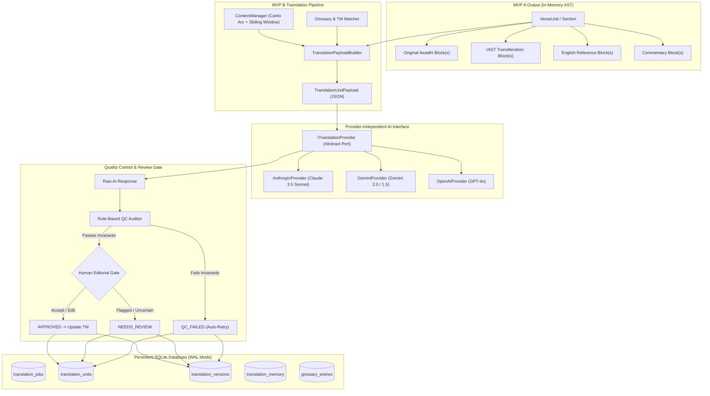
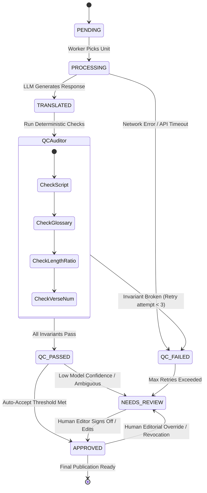
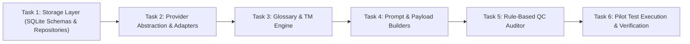

# MVP B Architecture Plan: The Russian Translation Engine

**Document**: `docs/mvp-b-translation-engine-plan.md`  
**Status**: DRAFT FOR ARCHITECTURAL APPROVAL  
**Target Book**: Gita Press *Ramcharit Manas* (1,200 pages, Awadhi / Sanskrit / English)  
**Deliverable**: Lean, robust, provider-independent Russian Translation Engine  
**Checkpoint Baseline**: Git commit `363abd9` (MVP A completed and accepted)

---

## 1. Executive Summary & Core Philosophy

The primary objective of **MVP B** is to construct the smallest, most reliable translation engine capable of producing publication-grade Russian translations of the *Ramcharit Manas* from the canonical AST and `VerseUnit` data structures generated by MVP A.

### Core Translation Principles:
1. **The Awadhi/Sanskrit Original is Authoritative**: Translation must proceed directly from the original verse (`original_script_block_ids`). The English translation provided in the Gita Press edition serves strictly as an auxiliary interpretive aid for archaic idioms, **never** as an intermediate pivot language.
2. **Structural Preservation**: Every verse unit preserves its metrical classification (`DOHA`, `CHAUPAI`, `SLOKA`, `CHHANDA`, `SORATHA`, `MANTRA`), its verse numbering, its IAST transliteration, and its distinct commentary apparatus.
3. **No Hallucination or Omission**: The engine must never silently drop lines, invent narrative details, or merge unlinked verses.
4. **Vedic/Vaishnava Theological Precision**: Strict terminology enforcement ensures divine names, epithets, philosophical concepts, and narrative relationships adhere to the elevated literary tradition of Vaishnava scholarship in Russian (e.g., distinguishing *Бхагаван*, *Господь*, *дэвы*, *бхакты*, *майя*).
5. **Resumable, Crash-Proof State**: All translation progress, retries, token costs, and human corrections are atomically persisted in a local SQLite database (WAL mode), enabling zero-loss resumption after any power or network failure.

---

## 2. High-Level Architecture & Component Decomposition



### Component Responsibilities:
1. **`TranslationPayloadBuilder`**: Compiles a single `VerseUnit` or unmetered `Section` into a rich, self-contained translation request containing source text, phonetics, reference translation, contextual summaries, and matched glossary items.
2. **`ContextManager`**: Maintains the global book narrative arc (Canto/Kanda), the specific episode setting, the active speaker/listener dialogue pairs (e.g. Shiva–Parvati, Kakabhushundi–Garuda), and a sliding window of the last 2 translated verses.
3. **`ITranslationProvider`**: An abstract, provider-agnostic port defining a uniform interface for LLM completions with native structured schema validation, rate-limiting, and error handling.
4. **`RuleBasedQCAuditor`**: Immediate post-processing validator that tests deterministic invariants (script purity, glossary adherence, reference number preservation, length ratio).
5. **`SQLiteTranslationStore`**: Atomic, persistent storage for job status, unit lifecycle states, version histories, and translation memory.

---

## 3. AI Provider Evaluation & Recommendation

To translate 1,200 pages (~6,238 `VerseUnits`) of 16th-century sacred Awadhi poetry into literary Russian, we evaluated the three primary enterprise AI provider platforms:

| Evaluation Dimension | Anthropic (Claude 3.5 Sonnet) | Google (Gemini 2.0 Flash / 1.5 Pro) | OpenAI (GPT-4o / GPT-4o-mini) |
| :--- | :--- | :--- | :--- |
| **Russian Literary Register** | **Exceptional (Top-Tier)**: Produces natural, elevated, poetic Russian phrasing with correct theological nuances; avoids bureaucratic modernisms. | **Good to Very Good**: 1.5 Pro has strong semantic depth; 2.0 Flash is rapid and clear, but prose can lean modern/analytical. | **Very Good**: Grammatically immaculate, but tends toward standardized contemporary Russian prose unless heavily steered. |
| **Indic / Vedic Script Comprehension** | **Strong**: Good understanding of Sanskrit and Hindi grammar; relies well on parallel IAST + Devanagari. | **Exceptional**: Industry-leading Devanagari and Hindi/Awadhi tokenization and vocabulary awareness from vast Indic corpora. | **Strong**: Good multilingual tokenization; occasionally confuses archaic Awadhi verb inflections. |
| **Context Capacity & Caching** | 200K tokens; prompt caching supported (50% input cost reduction on prefix). | **1M+ tokens**; native prompt caching with extremely low cache-read costs. | 128K tokens; automatic prompt caching supported. |
| **Structured Output Reliability** | Excellent via Tool Calling (`tool_choice`). | Excellent via native `response_schema` (Pydantic / JSON schema). | Excellent via `Strict JSON Schema` (`json_object` / schema). |
| **Input Cost (per 1M tokens)** | $3.00 (Sonnet) / $0.80 (Haiku 3.5) | **$0.10 (2.0 Flash)** / $1.25 (1.5 Pro) | $2.50 (GPT-4o) / $0.15 (4o-mini) |
| **Output Cost (per 1M tokens)** | $15.00 (Sonnet) / $4.00 (Haiku 3.5) | **$0.40 (2.0 Flash)** / $5.00 (1.5 Pro) | $10.00 (GPT-4o) / $0.60 (4o-mini) |
| **Full Book Estimate (6.2K Units)** | **~$35 – $45** (Sonnet) | **~$1.50 – $3.00** (2.0 Flash) / ~$15 (1.5 Pro) | ~$25 – $35 (4o) / ~$2.00 (4o-mini) |

### Provider Recommendation for MVP B:

> **Recommended Primary Provider**: **Anthropic Claude 3.5 Sonnet**  
> *Reason*: Translating sacred scripture into Russian is fundamentally an exercise in **literary and theological register**. Claude 3.5 Sonnet consistently outperforms other models in producing elevated, reverent, and syntactically balanced Russian prose that avoids colloquial or robotic phrasing. At ~$35–$45 for the entire 1,200-page book, the cost difference is negligible compared to the massive reduction in human editorial rewriting time.

> **Recommended Alternative / Pilot Benchmark**: **Google Gemini 2.0 Flash / 1.5 Pro**  
> *Reason*: Because the interface is 100% provider-independent, Gemini can be plugged in immediately. Its ultra-low cost ($1.50–$3.00 for the entire book) and vast context make it ideal for rapid prototyping, background drafts, and comparative pilot evals.

---

## 4. Persistent SQLite Storage Schema

All translation state is stored locally in `data/translation_workspace.db` using SQLite with Write-Ahead Logging (`PRAGMA journal_mode=WAL;`). This guarantees ACID transactions and safe concurrent read/write access.

```sql
-- 1. High-level translation job
CREATE TABLE IF NOT EXISTS translation_jobs (
    job_id TEXT PRIMARY KEY,
    document_id TEXT NOT NULL,
    book_title TEXT NOT NULL,
    source_language TEXT NOT NULL DEFAULT 'awa',
    target_language TEXT NOT NULL DEFAULT 'ru',
    provider_name TEXT NOT NULL,
    model_name TEXT NOT NULL,
    status TEXT NOT NULL CHECK(status IN ('INITIALIZED', 'RUNNING', 'PAUSED', 'COMPLETED', 'FAILED')),
    total_units INTEGER NOT NULL DEFAULT 0,
    completed_units INTEGER NOT NULL DEFAULT 0,
    failed_units INTEGER NOT NULL DEFAULT 0,
    config_json TEXT NOT NULL,
    created_at TEXT NOT NULL,
    updated_at TEXT NOT NULL
);

-- 2. Individual translation units (1:1 with VerseUnit or unmetered Section)
CREATE TABLE IF NOT EXISTS translation_units (
    unit_id TEXT PRIMARY KEY,
    job_id TEXT NOT NULL REFERENCES translation_jobs(job_id) ON DELETE CASCADE,
    canonical_id TEXT,
    unit_type TEXT NOT NULL,
    sequence_order INTEGER NOT NULL,
    chapter_index INTEGER NOT NULL,
    section_index INTEGER NOT NULL,
    content_hash TEXT NOT NULL, -- SHA256(original + translit + english)
    source_original_text TEXT NOT NULL,
    source_transliteration_text TEXT,
    source_reference_english TEXT,
    source_commentary TEXT,
    status TEXT NOT NULL CHECK(status IN ('PENDING', 'PROCESSING', 'TRANSLATED', 'QC_FAILED', 'QC_PASSED', 'NEEDS_REVIEW', 'APPROVED')),
    attempts INTEGER NOT NULL DEFAULT 0,
    last_error TEXT,
    created_at TEXT NOT NULL,
    updated_at TEXT NOT NULL
);

CREATE INDEX IF NOT EXISTS idx_units_job_status ON translation_units(job_id, status);
CREATE INDEX IF NOT EXISTS idx_units_content_hash ON translation_units(content_hash);
CREATE INDEX IF NOT EXISTS idx_units_sequence ON translation_units(sequence_order);

-- 3. Versioned translation results (Audit trail of AI drafts and human edits)
CREATE TABLE IF NOT EXISTS translation_versions (
    version_id TEXT PRIMARY KEY,
    unit_id TEXT NOT NULL REFERENCES translation_units(unit_id) ON DELETE CASCADE,
    version_number INTEGER NOT NULL,
    source_stage TEXT NOT NULL CHECK(source_stage IN ('AI_DRAFT', 'HUMAN_EDIT', 'RETRANSLATION')),
    translated_verse_russian TEXT NOT NULL,
    translated_commentary_russian TEXT,
    translator_notes TEXT,
    confidence_assessment_json TEXT,
    qc_results_json TEXT,
    token_usage_json TEXT,
    model_name TEXT,
    editor_id TEXT, -- NULL for AI, human username/id for manual edits
    created_at TEXT NOT NULL
);

CREATE INDEX IF NOT EXISTS idx_versions_unit_num ON translation_versions(unit_id, version_number);

-- 4. Terminology Glossary
CREATE TABLE IF NOT EXISTS glossary_entries (
    term_id TEXT PRIMARY KEY,
    source_term TEXT NOT NULL, -- Devanagari or IAST
    canonical_russian TEXT NOT NULL, -- Nominative singular
    grammatical_gender TEXT CHECK(grammatical_gender IN ('M', 'F', 'N')),
    declensions_json TEXT, -- {"gen": "...", "dat": "...", "acc": "...", "ins": "...", "prep": "..."}
    semantic_scope TEXT NOT NULL, -- 'PHILOSOPHICAL', 'CHARACTER_NAME', 'EPITHET', 'RITUAL'
    usage_notes TEXT,
    banned_translations_json TEXT, -- e.g. ["бог", "рок", "судьба"]
    is_active INTEGER NOT NULL DEFAULT 1,
    created_at TEXT NOT NULL
);

CREATE INDEX IF NOT EXISTS idx_glossary_source ON glossary_entries(source_term);

-- 5. Translation Memory (Exact and high-similarity cache)
CREATE TABLE IF NOT EXISTS translation_memory (
    tm_id TEXT PRIMARY KEY,
    source_hash TEXT UNIQUE NOT NULL, -- SHA256 of normalized source text
    source_text TEXT NOT NULL,
    target_text TEXT NOT NULL,
    source_language TEXT NOT NULL,
    target_language TEXT NOT NULL,
    provenance TEXT NOT NULL CHECK(provenance IN ('HUMAN_APPROVED', 'AI_DRAFT')),
    created_at TEXT NOT NULL,
    last_used_at TEXT NOT NULL
);

CREATE INDEX IF NOT EXISTS idx_tm_hash ON translation_memory(source_hash);
```

---

## 5. Structured Translation Prompt & Payload Design

### A. Input Payload Schema (`TranslationUnitPayload`)
```json
{
  "unit_id": "8f3b2d10-...",
  "canonical_id": "1.188",
  "unit_type": "DOHA",
  "canto_info": {
    "canto_name": "Bala Kanda",
    "canto_index": 1,
    "narrative_episode": "The Appearance of Lord Sri Rama in Ayodhya",
    "active_speakers": "Tulsidas / Narration"
  },
  "source_content": {
    "original_devanagari": "कौसल्यादि नारि सब चरन बिपुल मुनि बंदि।\nपति अनुकूल प्रेम दृढ़ हरि पद कमल बिनीत॥ 188॥",
    "transliteration_iast": "kausalyādi nāri saba carana bipula muni bandi |\npati anukūla prema dṛḍha hari pada kamala binīta || 188 ||",
    "supporting_reference_english": "(188) Adoring the feet of the numerous sages, Kausalya and all other queens, who were devoted to their lord, steadfast in love and meek at heart, clung to the lotus feet of Sri Hari.",
    "source_commentary_english": null
  },
  "glossary_terms": [
    {
      "term": "Kausalya",
      "canonical_russian": "Каушалья",
      "declensions": {"gen": "Каушальи", "dat": "Каушалье", "acc": "Каушалью", "ins": "Каушальей", "prep": "о Каушалье"},
      "notes": "Mother of Lord Rama; preserve soft 'ль' in Russian orthography."
    },
    {
      "term": "Hari",
      "canonical_russian": "Хари",
      "declensions": {"gen": "Хари", "dat": "Хари", "acc": "Хари", "ins": "Хари", "prep": "о Хари"},
      "notes": "Epithet of the Supreme Lord; indeclinable in Russian."
    }
  ],
  "preceding_context": [
    {
      "canonical_id": "1.187",
      "russian_verse": "Господь, источник всякого блага, явил Свой божественный образ..."
    }
  ]
}
```

### B. System Prompt Design
The system prompt explicitly commands the model to act as a scholar-poet and theologian:
```text
You are an expert scholar and literary translator of sacred Vedic and Bhakti texts into Russian, specializing in Goswami Tulsidas's Sri Ramcharit Manas.

TRANSLATION DIRECTIVES:
1. AUTHORITATIVE SOURCE:
   - Your primary and authoritative source is the Awadhi Devanagari text (<original_devanagari>) supported by its IAST phonetics (<transliteration_iast>).
   - The English text (<supporting_reference_english>) is only a secondary reference provided by Gita Press to clarify archaic Awadhi idioms. DO NOT translate from the English. Never produce English calques.

2. RUSSIAN LITERARY & THEOLOGICAL REGISTER:
   - Use elevated, dignified, and poetically resonant Russian prose (высокий литературный стиль).
   - Use sacred Vaishnava terminology correctly:
     * Translate references to the Supreme Lord as "Господь", "Всевышний", or "Бхагаван" (capitalized).
     * Distinguish the Supreme Lord from devas ("полубоги" or "дэвы").
     * Avoid dry bureaucratic language, modern colloquialisms, or Western ecclesiastical jargon (do not use "грех", "молитвенник", "спасение души" unless direct Bhakti equivalents apply).
   - Strictly adhere to the injected glossary terms and their Russian declension cases.

3. STRUCTURE & FIDELITY:
   - Preserve the verse numbering exactly (e.g. "|| 188 ||" or "(188)").
   - Never omit lines, syllables, or epithets.
   - Separate the metrical verse translation from any commentary or purport.
   - If an Awadhi passage has a double meaning (shlesha) or theological nuance, explain it in "translator_notes", not by overloading the verse text.

4. OUTPUT FORMAT:
   Return strictly valid JSON conforming to the requested schema.
```

### C. Enforced Output JSON Schema (`TranslationResponse`)
```json
{
  "type": "object",
  "properties": {
    "canonical_id": { "type": "string" },
    "russian_verse": { "type": "string", "description": "The elevated Russian translation of the verse." },
    "russian_commentary": { "type": ["string", "null"], "description": "Translation of commentary/purport, if present in source." },
    "translator_notes": { "type": ["string", "null"], "description": "Brief scholarly notes on obscure idioms or theological terms." },
    "confidence_assessment": {
      "type": "object",
      "properties": {
        "linguistic_certainty": { "type": "string", "enum": ["HIGH", "MEDIUM", "LOW"] },
        "theological_clarity": { "type": "string", "enum": ["HIGH", "MEDIUM", "LOW"] },
        "ambiguity_notes": { "type": ["string", "null"] }
      },
      "required": ["linguistic_certainty", "theological_clarity"]
    }
  },
  "required": ["canonical_id", "russian_verse", "confidence_assessment"]
}
```

---

## 6. Configurable Vaishnava Glossary & Translation Memory

### A. Seed Vaishnava Glossary (Ramcharit Manas Core Terms)
A pre-seeded database of theological terms and character names with Russian declension paradigms:

| Source Term (IAST / Dev) | Canonical Russian | Gender | Declensions (Gen / Dat / Acc / Ins / Prep) | Theological Category | Banned Renderings |
| :--- | :--- | :---: | :--- | :--- | :--- |
| **Rāma** (राम) | **Рама** | M | Рамы / Раме / Раму / Рамой / о Раме | Supreme Lord | бог, царевич (когда речь о Боге) |
| **Hari** (हरि) | **Хари** | M | (indeclinable in Russian: Хари) | Supreme Lord | Харий |
| **Kṛpā** (कृपा) | **Милость** | F | милости / милости / милость / милостью / о милости | Divine Attribute | жалость, пощада |
| **Bhakti** (भक्ति) | **Бхакти / преданность** | F | бхакти / бхакти / бхакти / бхакти / о бхакти | Practice | культ, поклонение |
| **Māyā** (माया) | **Майя** | F | майи / майе / майю / майей / о майе | Divine Energy | иллюзия (без контекста энергии Бога) |
| **Kausalyā** (कौसल्या) | **Каушалья** | F | Каушальи / Каушалье / Каушалью / Каушальей / о Каушалье | Persona | Кошалья |
| **Caraṇa-kamala** (चरन कमल) | **Лотосные стопы** | Pl | лотосных стоп / лотосным стопам / лотосные стопы / лотосными стопами / о лотосных стопах | Sacred Metaphor | ноги-цветы |
| **Dharma** (धर्म) | **Дхарма** | F | дхармы / дхарме / дхарму / дхармой / о дхарме | Philosophy | закон, религия, мораль |

### B. Translation Memory (TM) Matching Engine
1. **Exact Hash Match (`SHA-256`)**:
   - The normalized Awadhi text is hashed.
   - If an approved human translation exists (`provenance = 'HUMAN_APPROVED'`), the LLM call is **completely skipped**, saving API costs and guaranteeing 100% human consistency across identical refrains.
2. **Reverse Sync on Human Edit**:
   - Whenever an editor edits a verse in the review interface, the new Russian text is automatically upserted into `translation_memory` with `provenance = 'HUMAN_APPROVED'`.

---

## 7. Automated Quality Checks & Human Review Workflow



### Deterministic Automated Quality Checks (`RuleBasedQCAuditor`):
Automated checks are **hygiene gates**, not proofs of literary genius. They test:
1. **Script Purity**: Russian fields (`russian_verse`, `russian_commentary`) must contain Cyrillic characters; any residual Devanagari or untranslated Latin prose triggers failure.
2. **Glossary & Banned Term Enforcement**: Checks that mandatory terms from the matched glossary are present and that banned secular/impersonalist words (e.g. *рок*, *судьба*, *божок*) are absent.
3. **Expansion / Contraction Ratio**: Russian translations typically range between **0.8x and 1.6x** the character length of the original. Ratios $< 0.4x$ (truncation) or $> 3.0x$ (hallucination) trigger immediate failure.
4. **Verse Number & Anchor Preservation**: The numeric identifier (e.g. `188`, `॥ 188 ॥`) must appear in the translated output.
5. **JSON Schema Integrity**: Output must parse into `TranslationResponse` without schema errors.

### Human Review Gate:
- Units with high confidence and passing QC can be auto-routed or batched for editorial spot-checking.
- Units with ambiguous source text (e.g. those flagged in MVP A as `AMBIGUOUS`) or where `theological_clarity == "LOW"` are routed to `NEEDS_REVIEW`.
- In the review interface (CLI or Web Reader), human editors can:
  1. Approve the draft with one keystroke/click.
  2. Edit Russian phrasing directly in-place.
  3. Enter custom feedback and trigger a re-translation with targeted instructions.
  4. **Editorial Override / Revocation**: Reopen an `APPROVED` unit back to `NEEDS_REVIEW` if post-approval editorial revisions, glossary alignment, or corrections are required prior to final publication.

---

## 8. Pilot Test Plan (Pages 215–216, Bala Kanda)

To validate translation quality, provider responsiveness, and the end-to-end SQLite lifecycle before full-book processing, a pilot experiment will be executed on the **Appearance of Lord Sri Rama in Ayodhya** (Bala Kanda, Pages 215–216):

### Pilot Scope:
- **Passage**: Pages 215–216 of `data/test_books/Ramcharita_Manas_Gita_Press.pdf`.
- **Target Units**: 5 consecutive `VerseUnit`s:
  1. Chaupais 1–4 preceding Doha 188 (composite alignment).
  2. Doha 188 (the split couplet verified in MVP A).
  3. The renowned Stuti: *bhae pragaṭa kṛpālā dīnadayālā kausalyā hitakārī* (Chhanda).
  4. Subsequent Chaupais and Dohas.

### Verification Criteria:
1. **Russian Register**: Does the Stuti read as an elevated hymn in Russian (*«Явился Всемилостивый Господь, сострадательный к обездоленным...»*) rather than a dry mechanical sentence?
2. **Theological Accuracy**: Are terms like *Kṛpālā*, *Dīnadayālā*, *Kausalyā*, and *Hari* translated according to the Vaishnava glossary?
3. **Auxiliary Role of English**: Did the translation originate from the Awadhi text rather than being a Russian translation of Gita Press's 1960s archaic English?
4. **Idempotence & State Preservation**: Does SQLite properly track all 5 units from `PENDING` to `APPROVED`, storing token metrics and version history?

---

## 9. Cost Estimation Methodology & Projections

### Token Calculation Parameters:
- **Total Pages**: 1,200
- **Total VerseUnits**: 6,238
- **Average Input per Unit**:
  - System Prompt & Directives: ~350 tokens (cached)
  - Unit Source (Awadhi + IAST + English): ~120 tokens
  - Matched Glossary & Context Window: ~150 tokens
  - Total Input per Unit: **~620 tokens**
- **Average Output per Unit**:
  - Russian Verse + Commentary + JSON wrapper: **~200 tokens**

### Aggregate Full-Book Projections (6,238 Units):
- Total Input Tokens: $\approx 3.87\text{ M tokens}$ (with caching: $\approx 1.7\text{ M unique input tokens}$)
- Total Output Tokens: $\approx 1.25\text{ M tokens}$

| Provider / Model | Input Cost (Cached/Uncached) | Output Cost | Total Full-Book Cost Estimate |
| :--- | :---: | :---: | :---: |
| **Claude 3.5 Sonnet** (Anthropic) | ~$8.00 | ~$18.75 | **$26.75 – $35.00** |
| **Gemini 2.0 Flash** (Google) | ~$0.30 | ~$0.50 | **$0.80 – $1.50** |
| **Gemini 1.5 Pro** (Google) | ~$3.50 | ~$6.25 | **$9.75 – $14.00** |
| **GPT-4o-mini** (OpenAI) | ~$0.50 | ~$0.75 | **$1.25 – $2.00** |
| **GPT-4o** (OpenAI) | ~$6.50 | ~$12.50 | **$19.00 – $25.00** |

*Conclusion*: Even using the highest-tier literary model (Claude 3.5 Sonnet), translating the entire 1,200-page *Ramcharit Manas* costs under **$35**. Running the 5-unit pilot test will cost under **$0.05**.

---

## 10. Implementation Tasks in Dependency Order

The implementation of MVP B will proceed in six sequential, test-driven phases:



1. **Task 1: SQLite Storage Layer & Models** (`src/vedic_translator/translation_engine/storage/`)
   - Implement `TranslationStore` handling SQLite WAL connections, schema migrations, unit upsert, state transitions, and version tracking.
   - Comprehensive unit tests verifying atomic transactions and crash recovery.
2. **Task 2: Provider-Independent AI Interface** (`src/vedic_translator/translation_engine/providers/`)
   - Define `ITranslationProvider` abstract protocol.
   - Implement the selected primary provider adapter with rate limiting and exponential retry backoff.
   - Mocked unit tests verifying schema parsing and failure handling.
3. **Task 3: Vaishnava Glossary & Translation Memory** (`src/vedic_translator/translation_engine/glossary/`)
   - Implement `GlossaryManager` with seed dictionary and declension retrieval.
   - Implement `TranslationMemory` with exact hash matching and human sync.
4. **Task 4: Context Management & Payload Builder** (`src/vedic_translator/translation_engine/pipeline/`)
   - Implement `ContextManager` (canto narrative summaries and sliding window).
   - Implement `TranslationPayloadBuilder` connecting MVP A `VerseUnit`s to the translation engine.
5. **Task 5: Rule-Based Quality Auditor** (`src/vedic_translator/translation_engine/qc/`)
   - Implement `RuleBasedQCAuditor` verifying script purity, length ratios, verse number anchors, and glossary adherence.
6. **Task 6: End-to-End Pilot Execution & Quality Audit** (`tests/integration/test_translation_pilot.py`)
   - Execute the 5-unit pilot on Pages 215–216.
   - Generate a detailed pilot quality report comparing Awadhi original, English reference, and Russian draft for human approval.

---

## 11. Decisions Requiring User Approval

Before any implementation code is written or packages are configured, the following architectural decisions require your explicit sign-off:

1. **Primary AI Provider Selection**:
   - *Option A (Recommended)*: **Anthropic Claude 3.5 Sonnet** — Highest Russian literary quality, superior theological tone, ~$27–$35 for the full book.
   - *Option B*: **Google Gemini 2.0 Flash / 1.5 Pro** — Unmatched Indic script tokenization, vast context, lowest cost (~$1.50–$14.00 full book).
   - *Option C*: **OpenAI GPT-4o** — Highly standard multilingual output, ~$20–$25 full book.
2. **Translation Granularity**:
   - The primary translation unit will be the **`VerseUnit`** (averaging 1–4 lines of verse plus attached commentary), preserving the exact metrical boundaries established in MVP A.
3. **Human Gate Policy**:
   - Should high-confidence units with 100% passing QC be marked `APPROVED` automatically, or should *every* unit require explicit human sign-off in the pilot phase? (Recommended: In the pilot, require 100% human review; for full-book scaling, enable auto-approval for $> 0.90$ confidence units).
