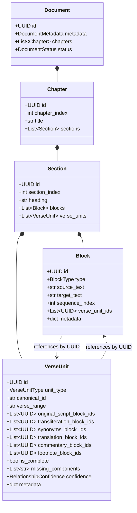

# Phase 1.2 Stage 2 Architecture Plan: Semantic Relationships & Fast-Path to First Translated Book

**Project**: Vedic Book Translator  
**Phase**: 1.2 — Semantic Verse & Commentary Segmenter  
**Stage**: Stage 2 — Relationship Resolution (Stage B)  
**Primary Deliverable**: Publication-Grade Russian Translation of Gita Press *Ramcharit Manas* on Private Web Reader  
**Status**: APPROVED by User with Mandatory Clarifications  
**Specification Document**: `docs/phase-1.2-stage-2-architecture-plan.md`  
**Date**: November 23, 2026  

---

## Executive Summary & Strategic Pivot

Our core vision is to build a **reusable, format-independent, multilingual translation platform** for sacred and classical literature. However, to maximize velocity and provide immediate tangible value, our execution strategy prioritizes the **shortest viable path to our first complete, published deliverable**:

> **Immediate Product Objective**:  
> A high-quality, verified Russian translation of the 1,200-page Gita Press *Ramcharit Manas*, accessible via a secure, private browser-based reading website with chapter navigation, reading progress, and publication-ready download capabilities (EPUB, PDF, DOCX).

To achieve this without compromising the long-term architecture:
1. **Universal Core, Pluggable Profiles**: The core domain model (`Document -> Chapter -> Section -> Block`) remains strictly universal and format-independent. Sacred verse structures (`VerseUnit`) are an **optional specialized overlay**, not a forced abstraction for ordinary books.
2. **Profile-Driven Specialization**: Book-specific conventions (e.g., Awadhi Chaupai/Doha meter prefixes, Sanskrit danda markers, BBT verse tags) are encapsulated in pluggable `RelationshipProfile` configurations rather than hardcoded into the core engine.
3. **Phased Fast-Path Delivery (MVP A $\rightarrow$ MVP B $\rightarrow$ MVP C)**: The roadmap is restructured into three lean, sequential milestones that progress directly from book extraction to translation and private web hosting without unnecessary microservices or infrastructure overhead.

```
+---------------------------------------------------------------------------------------------------------------+
|                                     FAST-PATH DELIVERY ROADMAP TO BOOK 1                                      |
+---------------------------------------------------------------------------------------------------------------+
|                                                                                                               |
|   [MVP A: Book Preparation] (Current Phase 1.2 Stage 2 — Authorized for Implementation)                       |
|   - Digital PDF Extraction & Font Normalization (Completed: 14,134 blocks, pristine Devanagari & IAST)        |
|   - Minimal Relationship Resolution (Awadhi Chaupai/Doha grouping & flexible English translation linking)     |
|   - Non-destructive Human Review Gate for uncertain relationships (JSON/CLI audit report)                     |
|                                                                                                               |
|                                                      │                                                        |
|                                                      ▼                                                        |
|   [MVP B: Translation Engine] (Subsequent Phase)                                                              |
|   - Native AI Provider Adapters (Anthropic Claude, Google Gemini, OpenAI) behind lean ITranslationProvider   |
|   - Primary Source: Original Awadhi / Hindi verse; Secondary Reference: Gita Press English translation        |
|   - Resumable translation jobs in chunked units with persistent SQLite checkpoints (safe restart & idempotent)|
|   - Book-wide Awadhi/Sanskrit -> Russian Glossary & Chapter/Section Narrative Context injection               |
|   - Trilingual comparison interface (Awadhi Source + English Reference -> Russian Target)                     |
|   - Human editorial sign-off & multi-dimensional QC checks                                                    |
|                                                                                                               |
|                                                      │                                                        |
|                                                      ▼                                                        |
|   [MVP C: Private Online Reading Website] (Subsequent Phase)                                                  |
|   - Lean single-process architecture: FastAPI (Python) + SQLite (WAL) + Responsive HTML5/Tailwind Reader      |
|   - Secure personal authentication (Session cookie / JWT for authorized readers; protected book access)       |
|   - Trilingual reading interface (Russian primary, expandable Awadhi verse, IAST transliteration, English)   |
|   - Seven Kandas Table of Contents, reading progress tracking, bookmarks, typography controls                |
|   - On-demand compilation & download of publication-grade EPUB 3, PDF, and DOCX                              |
+---------------------------------------------------------------------------------------------------------------+
```

---

## 1. Domain Architectural Principles & Mandatory Clarifications

### 1.1 Universal Hierarchy vs. Optional Scripture Overlays
- **The Canonical AST is Universal**: The core structure of every ingested work is `Document -> Chapter -> Section -> Block`. Every text passage is an atomic `Block` with an immutable `source_text`, unique `id: UUID`, and sequential `sequence_index`.
- **`VerseUnit` is an Additive Semantic Overlay**: 
  - In ordinary secular, academic, or prose literature, sections simply contain a list of `Block` objects (`section.blocks`). The `section.verse_units` list is empty (`[]`), and downstream translation operates directly block-by-block.
  - In verse-and-commentary scriptures (*Ramcharit Manas*, *Bhagavad-gita*, *Upanishads*), the segmenter instantiates `VerseUnit` objects in `section.verse_units` to link corresponding original verses, transliterations, word-for-word synonyms, running translations, and commentary paragraphs.
  - `VerseUnit` references blocks strictly by `UUID` (`original_script_block_ids`, `translation_block_ids`, etc.), keeping the AST flat and eliminating circular object dependencies.

### 1.2 Pluggable Linguistic & Structural Profiles
The engine does not hardcode Awadhi, Sanskrit, or Hindi syntax into the core codebase. Instead, the relationship resolution engine receives a pluggable `RelationshipProfile`:
- **`RamcharitaManasProfile`**: Configured with Awadhi metrical markers (`दो0ó` / `Do.:`, `चौ0ó` / `Cau.:`, `सो0ó` / `So.:`, `छं0ó` / `Chh.:`), sub-verse notation (`1 (क)` / `1(A)`), and Chaupai-to-Doha grouping conventions.
- **`VedicClassicalProfile`**: Configured with Sanskrit danda delimiters (`॥ 1॥`), standard five-element Vedic commentary flow (`VERSE` $\rightarrow$ `IAST` $\rightarrow$ `SYNONYMS` $\rightarrow$ `TRANSLATION` $\rightarrow$ `PURPORT`), and chapter-verse notation (`2.13`).
- **`StandardProseProfile`**: Default profile for general literature, linking headings, body paragraphs, and blockquotes without verse logic.

### 1.3 Flexible Source-to-Translation Alignment (Mandatory Clarification A)
Never assume that one Awadhi verse always corresponds to exactly one English translation block. The architecture must natively support:
1. **One Verse $\rightarrow$ Multiple Translation Blocks ($1:N$)**: A lengthy verse whose English translation spans multiple paragraphs or blocks.
2. **Multiple Verses $\rightarrow$ One Shared Translation Block ($N:1$)**: Composite translations where verses 1 through 4 are translated together in a single block.
3. **Many-to-Many Relationships ($N:M$)**: Composite verses translated across multiple joint paragraphs.
4. **Uncertain or Ambiguous Relationships**: When block pairing cannot be established with high confidence, the system leaves relationships unforced and tags them as `AMBIGUOUS` or `FLAGGED_FOR_REVIEW`.
5. **Non-Destructive Manual Review**: Flagged blocks are exported to an audit JSON file (`editorial_review_needed.json`). Human editors can assign or override relationships without losing or modifying original text blocks.
6. **No Silent Forcing**: The resolver must NEVER silently force an uncertain association or fabricate synthetic blocks.

### 1.4 Confidence Calibration vs. Linguistic Verification (Mandatory Clarification B)
- **Heuristic Indicators, Not Linguistic Proof**: Automatic classification and relationship resolution scores are **structural heuristic indicators**, NOT certified linguistic correctness. They reflect layout geometry, regex anchors, and sequence flow.
- **Configurable Thresholds**: Confidence thresholds (e.g., $0.85$ for `AUTO_ACCEPTED`, $0.60$ for `AMBIGUOUS`) are defined in `RelationshipProfile`, not hardcoded as constants.
- **Audit Logging of Evidence & Reasoning**: Each `RelationshipConfidence` record captures:
  - `overall_score`: Bounded float $[0.0, 1.0]$.
  - `routing_action`: `AUTO_ACCEPTED`, `AMBIGUOUS`, or `FLAGGED_FOR_REVIEW`.
  - `provenance_rules`: Names of applied rules (e.g., `awadhi_doha_prefix`, `exact_numeric_anchor`).
  - `evidence`: Specific tokens, matched patterns, or spatial cues observed.
  - `reasoning`: Human-readable explanation of why the score was computed.

---

## 2. Minimum Stage 2 Scope Required Before Translation (MVP A)

To begin MVP B (Translation) as rapidly as possible, we strictly delineate the **minimum required Stage 2 functionality** from features that can safely be postponed until after Book 1 is published.

### 2.1 Minimum Required Scope (Must Complete in MVP A)
1. **Lightweight Relational Domain Models**:
   - `VerseUnit` with list-based block references (`original_script_block_ids`, `transliteration_block_ids`, `translation_block_ids`, `commentary_block_ids`, `footnote_block_ids`).
   - `Section.verse_units: list[VerseUnit]` and `Block.verse_unit_ids: list[UUID]`.
   - `RelationshipConfidence` with evidence and reasoning fields.
2. **`RamcharitaManasProfile` & Profile-Driven Resolver**:
   - Group contiguous split-block Chaupais and Dohas ($1:N$ verse grouping).
   - Flexibly associate Awadhi verse groups with English translation blocks ($1:1$, $1:N$, $N:1$).
   - Identify section headings, Kandas (Cantos), and doha numbers.
3. **Non-Destructive Human Review Gate**:
   - Flag uncertain links (`AMBIGUOUS` or `FLAGGED_FOR_REVIEW`) and export an editorial anomaly summary (`data/temp/editorial_review_needed.json`) allowing a human editor to review or override associations before translation begins.
4. **Relational Integrity Validation**:
   - Enforce referential closure (every referenced block UUID exists within the document), bidirectional pointer consistency, and sequence monotonicity.

### 2.2 Postponed Capabilities (Deferred to Post-Book 1)
- **Generalized Sanskrit Meter Recognition**: Syllable-weight scanning for Anuṣṭubh, Triṣṭubh, Śārdūlavikrīḍita. *(Ramcharit Manas uses Awadhi Matrik meters).*
- **Hierarchical Multi-Nested Footnote Trees**: Complex footnote-to-footnote graphs. *(Standard 1:1 footnotes are handled as `FOOTNOTE` blocks).*
- **Cross-Document Hyperlinking**: Inter-book citations.
- **Automated AI-Based Relational Healing**: Using secondary LLMs to guess broken links. *(Deterministic FSM + Human Review is faster, cheaper, and 100% reliable).*

---

## 3. Fast-Path Delivery Roadmap (MVPs A, B, C)

### 3.1 MVP A — Book Preparation (Current Scope)
- **Objective**: Transform raw extracted PDF blocks into a validated, semantically linked Document AST for the *Ramcharit Manas*.
- **Key Milestones**:
  - Implement `VerseUnit` and update `Section.verse_units` / `Block.verse_unit_ids`.
  - Implement `RelationshipProfile` and `RamcharitaManasProfile`.
  - Implement `RuleBasedRelationshipResolver` supporting $1:1$, $1:N$, $N:1$, and $N:M$ linking.
  - Run relationship resolution on all 1,200 pages (14,134 blocks).
  - Export ambiguous cases to `data/temp/editorial_review_needed.json`.
- **Exit Gate**: 100% of *Ramcharit Manas* Kandas structured and approved for translation input.

### 3.2 MVP B — Translation Engine (Subsequent Phase — Mandatory Clarification D)
- **Objective**: Execute high-fidelity Russian translation using LLMs informed by Awadhi verse roots, Roman transliteration, and Gita Press English commentary.
- **Theological & Linguistic Hierarchy**:
  - **Primary Authoritative Source**: The original Awadhi text in Devanagari script (with IAST transliteration).
  - **Secondary Reference**: The existing Gita Press English translation. English provides semantic context and clarity on archaic Awadhi idioms, but **English must never silently replace the original Awadhi as the authoritative source**.
- **Context Injection**:
  - **Book-Wide Context**: Global work overview, Vaishnava philosophical framework, Ramcharit Manas story progression.
  - **Chapter & Section Context**: Context of the current Kanda, preceding verses, and narrative situation provided with each translation chunk.
  - **Consistent Terminology & Glossary**: Pre-compiled Awadhi/Sanskrit-to-Russian theological glossary enforcing standard terms (*Rāma* $\rightarrow$ Рама, *Bhakti* $\rightarrow$ бхакти, *Dharma* $\rightarrow$ дхарма) and Cyrillic diacritic standards.
- **Resumable Chunked Translation**:
  - Batches of 5–10 verses processed per atomic job.
  - Persistent state in SQLite (job status, prompt, raw LLM response, parsed translation, cost/token metrics).
  - Safe resume after process restart; idempotent chunk processing.
- **Human Editorial Review**:
  - Side-by-side trilingual alignment (Awadhi Source + English Reference + Russian Translation).
  - Ability for human editor to revise Russian text before marking `APPROVED`.

### 3.3 MVP C — Private Online Reading Website (Subsequent Phase — Mandatory Clarification C)
- **Objective**: Deploy a secure, private, responsive web application for reading and downloading the translated *Ramcharit Manas*.
- **Reliable Deployment Foundation**:
  - **Single-Process FastAPI Backend**: High-performance, lightweight, importing core domain models directly.
  - **SQLite Database with WAL Mode**: Single-file ACID database (`PRAGMA journal_mode=WAL;`), supporting concurrent reads and background writes.
  - **Persistent Server Storage**: Database and book files reside on persistent storage with automated backup snapshots (`VACUUM INTO` backup script).
  - **Persistent Job State**: Translation jobs and progress are tracked in SQLite tables, not only in transient in-memory asyncio state. Safe resumption after server reboot.
  - **Authenticated Access**: Mandatory session cookie / JWT authentication; private books and generated export files cannot be accessed without login.
- **Web Reader Features**:
  - Responsive HTML5 + Tailwind CSS interface (clean typography for Cyrillic and Sanskrit diacritics).
  - Trilingual reading view (Russian primary text with expandable Awadhi original and English reference).
  - Seven Kandas Table of Contents, reading progress, and bookmarks.
  - On-demand download of publication-grade EPUB 3, formatted DOCX, and PDF.

---

## 4. Proposed Data Models & Relational Architecture

The relational model utilizes flat, list-based referential identifiers (`UUID`), ensuring zero cyclic references, seamless Pydantic serialization, and complete compatibility with SQLite storage.

### 4.1 Schema Overview



### 4.2 Data Model Implementations (`src/vedic_translator/core/models.py`)

```python
class VerseUnitType(StrEnum):
    """Metrical or functional classification of scripture unit."""
    SLOKA = "SLOKA"                  # Classical Sanskrit verse (Anushtubh, etc.)
    DOHA = "DOHA"                    # Awadhi / Hindi rhyming couplet
    CHAUPAI = "CHAUPAI"              # Awadhi / Hindi 4-line stanza (16 matras)
    SORATHA = "SORATHA"              # Inverted doha meter
    CHHANDA = "CHHANDA"              # Metrical hymn / stotra
    MANTRA = "MANTRA"                # Vedic Samhita / Upanishadic prose-verse
    PROSE_SECTION = "PROSE_SECTION"  # Pure narrative / introductory prose
    GENERIC_VERSE = "GENERIC_VERSE"  # Universal metrical / poetic unit


class RoutingAction(StrEnum):
    """Provisional editorial routing decision."""
    AUTO_ACCEPTED = "AUTO_ACCEPTED"          # High confidence; ready for translation
    AMBIGUOUS = "AMBIGUOUS"                  # Medium confidence; candidate linked, flagged for QA
    FLAGGED_FOR_REVIEW = "FLAGGED_FOR_REVIEW"# Low confidence; unforced, requires human sign-off


class RelationshipConfidence(BaseModel):
    """Provisional structural heuristic confidence score and diagnostic audit trail."""
    overall_score: float = Field(ge=0.0, le=1.0)
    component_scores: dict[str, float] = Field(default_factory=dict)
    routing_action: RoutingAction = RoutingAction.AUTO_ACCEPTED
    provenance_rules: list[str] = Field(default_factory=list)
    evidence: list[str] = Field(default_factory=list)
    reasoning: str | None = None
    diagnostics: list[str] = Field(default_factory=list)


class VerseUnit(BaseModel):
    """Optional logical grouping of blocks representing a verse and its commentary apparatus."""
    id: UUID = Field(default_factory=uuid4)
    unit_type: VerseUnitType = VerseUnitType.GENERIC_VERSE
    canonical_id: str | None = None       # e.g., "1.188", "Cau. 1.188.1", "Do. 2 (A)"
    verse_range: str | None = None        # e.g., "1.21-1.22" for composite multi-verse units

    # List-based references to constituent blocks (strictly in reading order)
    original_script_block_ids: list[UUID] = Field(default_factory=list)
    transliteration_block_ids: list[UUID] = Field(default_factory=list)
    synonyms_block_ids: list[UUID] = Field(default_factory=list)
    translation_block_ids: list[UUID] = Field(default_factory=list)
    commentary_block_ids: list[UUID] = Field(default_factory=list)
    footnote_block_ids: list[UUID] = Field(default_factory=list)

    # Incompleteness tracking
    is_complete: bool = True
    missing_components: list[str] = Field(default_factory=list)

    # Confidence and audit routing
    confidence: RelationshipConfidence
    metadata: dict[str, Any] = Field(default_factory=dict)

    def all_block_ids(self) -> list[UUID]:
        """Return all referenced block UUIDs in logical reading sequence."""
        return (
            self.original_script_block_ids
            + self.transliteration_block_ids
            + self.synonyms_block_ids
            + self.translation_block_ids
            + self.commentary_block_ids
            + self.footnote_block_ids
        )
```

---

## 5. Profile-Driven Relationship Resolution Algorithm

### 5.1 Architecture of `IRelationshipResolver`

```python
class RelationshipProfile(BaseModel):
    """Configurable profile defining book-specific structural patterns, weights, and thresholds."""
    name: str = "generic_profile"
    
    # Metrical anchor patterns (regex)
    verse_number_patterns: list[str] = Field(default_factory=list)
    metrical_marker_patterns: dict[str, str] = Field(default_factory=dict)
    translation_anchor_patterns: list[str] = Field(default_factory=list)
    footnote_anchor_patterns: list[str] = Field(default_factory=list)
    
    # Configurable confidence weights
    weight_anchor_match: float = 0.40
    weight_sequence_flow: float = 0.30
    weight_spatial_proximity: float = 0.20
    weight_script_consistency: float = 0.10
    
    # Configurable threshold gates (provisional)
    threshold_auto_accept: float = 0.85
    threshold_ambiguous: float = 0.60


class IRelationshipResolver(ABC):
    """Abstract port for resolving semantic relationships between classified blocks."""
    @abstractmethod
    def resolve_relationships(
        self, section: Section, profile: RelationshipProfile
    ) -> list[VerseUnit]:
        """Resolve relationships for blocks within a section, returning VerseUnits."""
        ...
```

### 5.2 The `RamcharitaManasProfile` Configuration

```python
RAMCHARITA_MANAS_PROFILE = RelationshipProfile(
    name="ramcharita_manas_gita_press",
    verse_number_patterns=[
        r"॥\s*(\d+)\s*॥",                    # e.g., ॥ 188॥
        r"॥\s*(\d+)\s*\(([क-ह])\)\s*॥",      # e.g., ॥ 2 (क)॥
        r"\b(?:Do\.|So\.|Cau\.)\s*(\d+)",    # e.g., Do. 188, Cau. 1
        r"\(([0-9]+(?:\s*[A-Z])?)\)",        # e.g., (188), (2 A)
    ],
    metrical_marker_patterns={
        "दो0ó": VerseUnitType.DOHA,
        "चौ0ó": VerseUnitType.CHAUPAI,
        "सो0ó": VerseUnitType.SORATHA,
        "छं0ó": VerseUnitType.CHHANDA,
        "श्लोक": VerseUnitType.SLOKA,
        "Do.:": VerseUnitType.DOHA,
        "Cau.:": VerseUnitType.CHAUPAI,
        "So.:": VerseUnitType.SORATHA,
        "Chh.:": VerseUnitType.CHHANDA,
        "Sloka:": VerseUnitType.SLOKA,
    },
    translation_anchor_patterns=[
        r"^\(([0-9]+(?:\s*[A-Z])?)\)$",      # e.g. (188), (2 A)
        r"^[“\"][A-Z]",                      # English quote opening
    ],
    footnote_anchor_patterns=[
        r"\[\^?(\d+)\]",
        r"\(([0-9]+)\)",
    ],
    threshold_auto_accept=0.85,
    threshold_ambiguous=0.60,
)
```

### 5.3 Deterministic Multi-Pass Resolution Logic
1. **Pass 1: Anchor Tokenization**: Extract explicit numbers and metrical tags. Capture raw matched tokens as evidence.
2. **Pass 2: Contiguity Grouping (Split Verses)**: Consecutive `VERSE_DEVANAGARI` blocks without intervening numbers are merged into a single `original_script_block_ids` list.
3. **Pass 3: Flexible Alignment State Machine**:
   - Evaluates $1:1$, $1:N$, $N:1$, and $N:M$ relationships between original verses and translation blocks.
   - If multiple verses precede a composite translation (e.g., translation covers verses 1–4), links the translation block to all constituent `VerseUnit` instances.
   - If a verse is followed by multiple translation blocks (e.g., split across paragraphs), captures all translation block UUIDs in `translation_block_ids`.
   - Never silently forces an association when sequence or anchors disagree; tags as `AMBIGUOUS`.
4. **Pass 4: Confidence Scoring & Evidence Logging**:
   - Computes overall score based on profile weights.
   - Formulates human-readable `reasoning` and stores observed `evidence`.
   - Marks routing action: $\ge \text{threshold\_auto\_accept} \rightarrow \text{AUTO\_ACCEPTED}$, $\ge \text{threshold\_ambiguous} \rightarrow \text{AMBIGUOUS}$, else $\text{FLAGGED\_FOR\_REVIEW}$.

---

## 6. Architecture for Private Online Reading Website (MVP C)

To ensure reliable, low-maintenance deployment, MVP C uses a **lean, single-process, resource-efficient Python architecture** designed around persistent storage and crash recovery.

```
+---------------------------------------------------------------------------------------------------------------+
|                                    LEAN ONLINE DEPLOYMENT ARCHITECTURE                                        |
+---------------------------------------------------------------------------------------------------------------+
|                                                                                                               |
|   [CLIENT LAYER]                                                                                              |
|   - Responsive Browser Web App (HTML5 / Tailwind CSS / Vanilla JS or Alpine.js)                               |
|   - Mobile-friendly reading view, dark/sepia/light themes, trilingual collapsible display                     |
|                                                                                                               |
|                                                      │ HTTPS                                                  |
|                                                      ▼                                                        |
|   [APPLICATION SERVER (FastAPI in Single Container / VPS)]                                                    |
|   - FastAPI Web Framework (High performance, async, automatic OpenAPI docs)                                   |
|   - Authentication Middleware: Secure JWT / encrypted HTTP-only session cookie (protected endpoints)          |
|   - REST Endpoints:                                                                                           |
|     * GET /api/books                    -> Library list                                                       |
|     * GET /api/books/{id}/toc           -> Table of Contents (Seven Kandas)                                   |
|     * GET /api/books/{id}/chapters/{idx}-> Chapter text, verses & translations                                |
|     * POST /api/user/progress           -> Save reading position / bookmark                                   |
|     * GET /api/export/{id}/{format}     -> Trigger & download EPUB 3, PDF, or DOCX                            |
|                                                                                                               |
|                                                      │ Direct Import                                          |
|                                                      ▼                                                        |
|   [DOMAIN CORE & BACKGROUND WORKER]                                                                           |
|   - Python asyncio Background Task Runner (Resumable translation jobs, export rendering)                      |
|   - Domain Services: Document AST, Translation Pipeline, Publishing Exporters                                 |
|                                                                                                               |
|                                                      │ ACID I/O                                               |
|                                                      ▼                                                        |
|   [PERSISTENCE & STORAGE (Persistent Disk Mount)]                                                             |
|   - SQLite Database (WAL mode enabled):                                                                       |
|     * User credentials & sessions                                                                             |
|     * Book metadata & chapter-level AST records                                                               |
|     * Reading progress & bookmarks                                                                            |
|     * Background translation job state & progress (safe resume after reboot)                                  |
|   - Private File Store (`data/library/`, `data/exports/`):                                                    |
|     * Source PDFs, generated EPUBs, PDFs, DOCXs                                                               |
|     * Protected by FastAPI authentication check before file streaming                                         |
|     * Automated backup via SQLite VACUUM INTO snapshots                                                       |
+---------------------------------------------------------------------------------------------------------------+
```

---

## 7. Concrete Real-Book Validation Examples (*Ramcharit Manas*)

### Example 1: Awadhi Stanza & Dual-Couplet Unit (Page 215 / Doha 188)
```json
{
  "id": "f5a6b7c8-2222-4000-8000-000000000002",
  "unit_type": "DOHA",
  "canonical_id": "1.188",
  "original_script_block_ids": [
    "b2c3d4e5-0002-0000-0000-000000000001",
    "b2c3d4e5-0002-0000-0000-000000000002"
  ],
  "transliteration_block_ids": ["b2c3d4e5-0002-0000-0000-000000000003"],
  "translation_block_ids": ["b2c3d4e5-0002-0000-0000-000000000004"],
  "commentary_block_ids": [],
  "is_complete": true,
  "confidence": {
    "overall_score": 0.94,
    "routing_action": "AUTO_ACCEPTED",
    "provenance_rules": ["awadhi_doha_prefix", "exact_numeric_anchor"],
    "evidence": ["Prefix 'दो0ó'", "Danda marker '॥ 188 ॥'"],
    "reasoning": "Unambiguous Doha marker matching following danda number 188."
  }
}
```

### Example 2: Composite Translation Unit ($N:1$ Shared Translation)
```json
{
  "id": "a1b2c3d4-4444-4000-8000-000000000001",
  "unit_type": "CHAUPAI",
  "canonical_id": "1.2.1-4",
  "original_script_block_ids": [
    "c3d4e5f6-0001-0000-0000-000000000001",
    "c3d4e5f6-0002-0000-0000-000000000001"
  ],
  "transliteration_block_ids": [],
  "translation_block_ids": ["c3d4e5f6-0005-0000-0000-000000000001"],
  "is_complete": true,
  "confidence": {
    "overall_score": 0.88,
    "routing_action": "AUTO_ACCEPTED",
    "provenance_rules": ["awadhi_chaupai_meter", "composite_translation_anchor"],
    "evidence": ["Verses 1 to 4 precede joint translation '(1-4)'"],
    "reasoning": "Shared English translation block explicitly covering Chaupais 1 through 4."
  }
}
```

---

## 8. MVP A Implementation Tasks Breakdown

Stage 2 implementation is partitioned into **6 small, testable increments**:

```
Task A1: Relational Domain Models (VerseUnit, VerseUnitType, RelationshipConfidence)
   ↓
Task A2: Resolver Interface & RelationshipProfile (Configurable thresholds & weights)
   ↓
Task A3: RamcharitaManasProfile & RuleBasedRelationshipResolver (1:1, 1:N, N:1, evidence logging)
   ↓
Task A4: SegmenterPipeline Stage B Integration & DocumentIntegrityValidator Invariants
   ↓
Task A5: Unit & Integration Test Suite (Split verses, composite translations, edge cases)
   ↓
Task A6: Real-Book Execution & Anomaly Report Generation (1,200-page Ramcharit Manas)
```

1. **Task A1: Core Relational Models**: Add `VerseUnitType`, `RoutingAction`, `RelationshipConfidence`, `VerseUnit` to `src/vedic_translator/core/models.py`. Update `Section.verse_units: list[VerseUnit] = Field(default_factory=list)`.
2. **Task A2: Resolver Interface & Profile**: Create `src/vedic_translator/document_processor/segmenter/relationships/base.py` with `IRelationshipResolver` and `RelationshipProfile`.
3. **Task A3: Concrete Resolver & Ramcharit Manas Profile**: Implement `RamcharitaManasProfile` and `RuleBasedRelationshipResolver` in `src/vedic_translator/document_processor/segmenter/relationships/`, supporting $1:1$, $1:N$, $N:1$, and $N:M$ linking with non-destructive uncertainty handling.
4. **Task A4: Pipeline Integration & Validator**: Update `SegmenterPipeline.segment()` to run Stage B relationship resolution non-destructively. Extend `DocumentIntegrityValidator` to verify referential closure and bidirectional consistency.
5. **Task A5: Comprehensive Tests**: Implement unit and edge-case tests in `tests/unit/test_relationship_resolver.py`.
6. **Task A6: Real-Book Audit**: Run resolution on `Ramcharita_Manas_Gita_Press.pdf` and export uncertain blocks to `data/temp/editorial_review_needed.json`.

---

## 9. Record of Approved Decisions & Accepted Clarifications

- **Roadmap Sequence**: APPROVED — MVP A (Book Prep) $\rightarrow$ MVP B (Translation) $\rightarrow$ MVP C (Web Reader).
- **Domain Overlay**: APPROVED — Universal AST core (`Document` $\rightarrow$ `Chapter` $\rightarrow$ `Section` $\rightarrow$ `Block`), with `VerseUnit` as an optional overlay.
- **Provisional Thresholds**: APPROVED — Initial thresholds ($0.85$ / $0.60$) are provisional heuristics configurable per profile.
- **Online Architecture**: APPROVED — FastAPI + SQLite (WAL) + Tailwind Web Reader on persistent storage.
- **Clarification A (Flexible Alignment)**: ACCEPTED & INCORPORATED ($1:1$, $1:N$, $N:1$, $N:M$, non-destructive manual review, no silent forcing).
- **Clarification B (Confidence Calibration)**: ACCEPTED & INCORPORATED (configurable thresholds, explicit evidence and reasoning fields, structural heuristics decoupled from linguistic certification).
- **Clarification C (Deployment Foundation)**: ACCEPTED & INCORPORATED (persistent server disk, SQLite job state tracking, safe restarts, idempotent chunks, authenticated access).
- **Clarification D (Translation Quality)**: ACCEPTED & INCORPORATED (original Awadhi primary source, English secondary reference, book-wide and chapter context, glossary enforcement, human review, verse structure preservation).
